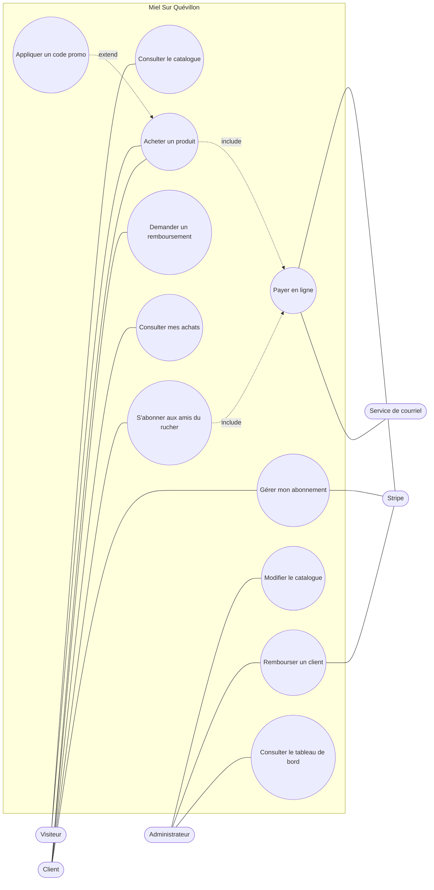
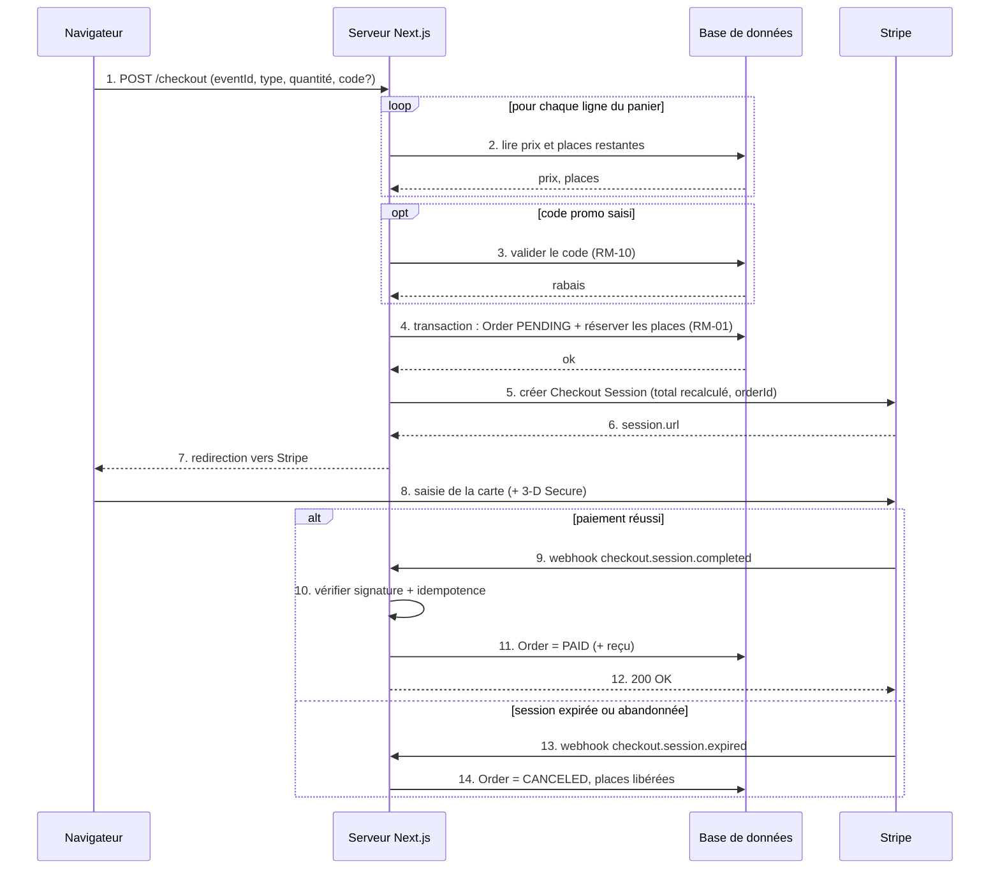
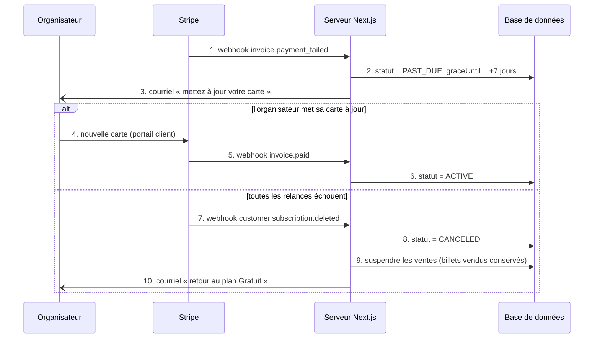
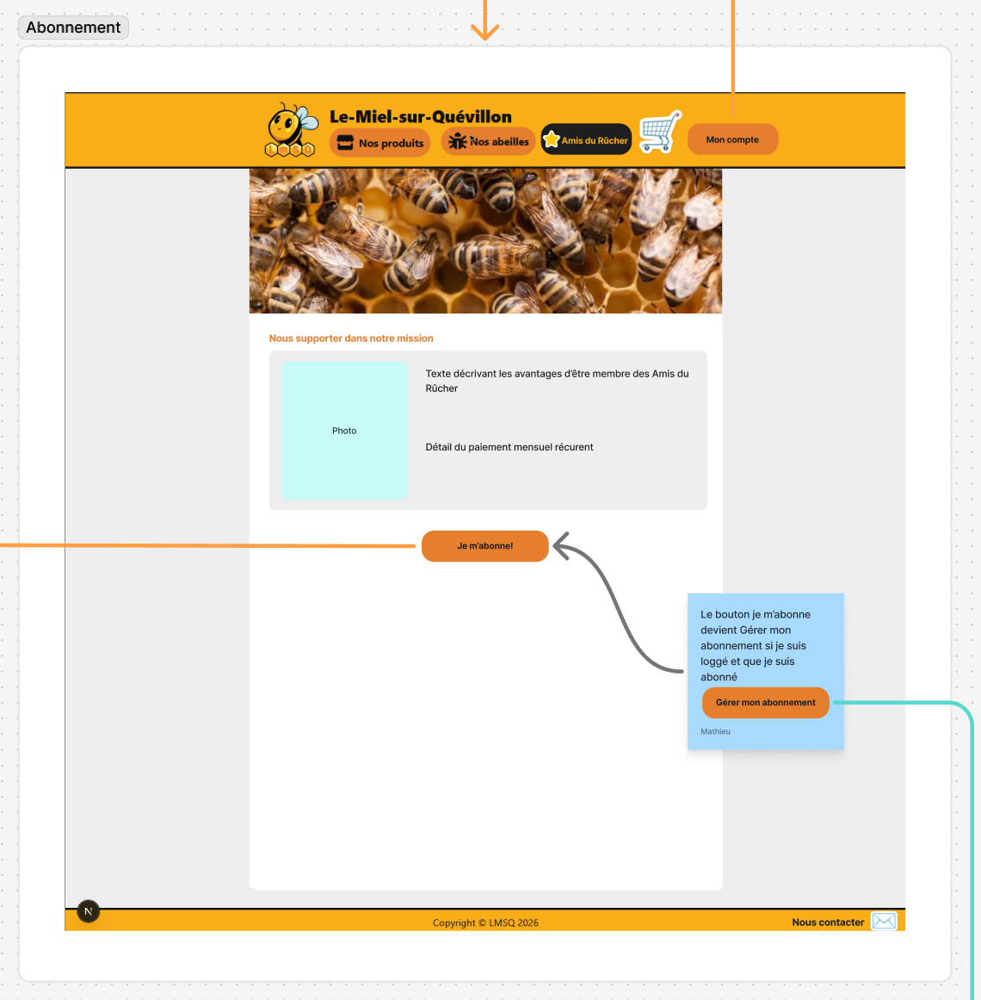
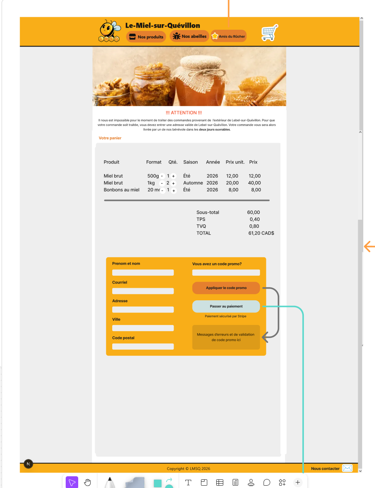
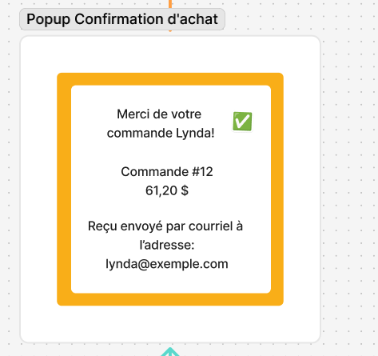

# Cahier des charges — SymposiQ

**Plateforme de gestion de congrès et de journées scientifiques**

| | |
|---|---|
| Cours | 420-951-MA Applications Web transactionnelles — groupe 25604 |
| Document | Laboratoire 1 |
| Version | 1.0 |
| Option | B — nouveau projet |
| Équipe | 3 membres (Mathieu Gosselin, Francis Boisvert, Clément Laflamme) |
| Modèle de paiement | Hybride : paiement unique (billets) **et** abonnement mensuel (plan Pro) |
| Stack | Next.js (App Router, TypeScript), Prisma, PostgreSQL (Neon), Clerk, Stripe, Zod, Vitest |

## Historique des versions

| Version | Moment | Modifications |
|---|---|---|
| 1.0 | Semaine 2, partie 2 | Périmètre, cas d'utilisation, user stories et critères, règles métier, exigences non fonctionnelles, diagrammes, maquettes, planification. |

---

## 1. Contexte et vision

### 1.1 Le problème

Le client aimerait centraliser les commandes pour que les clients cessent d'approcher les bénévoles sur Facebook afin d'obtenir du miel. Il s'agit d'une mielerie a but non lucratif.

- un vente en quantité limitée annoncée sur Facebook à tout le monde en même temps et un décompte papier du stock pour valider la disponibilité;
- des virements Interac ou de l'argent comptant à récolter auprès des clients à la livraison;
- un suivi chaotique du nombre de produits encore disponibles;

Résultat : les bénévoles reçoivent des dizaines de demandes d'inconnus qui cherchent à obtenir les produits de la saison qu'ils doivent traiter pour assurer la vente du miel. Ces mêmes bénévoles doivent ensuite communiquer entre eux pour s'assurer que la personne qui gère le stock ait l'information sur les quantités restantes. Un bénévole en particulier s'occupe des finances et doit démêler les ventes afin de connaître exactement combien d'argent la vente de miel a rapportée dans la saison.

### 1.2 La vision : Why, How, What

| | |
|---|---|
| **Why** | Simplifier la gestion des stocks et des ventes d'un OBNL auprès de la population locale. |
| **How** | En developpant une plateforme de gestion de commandes et de paiements en ligne. |
| **What** | Un site web transactionnel donnant la possibilitée de commander des produits du miel et de les payer en ligne ainsi qu'une offre d'abonnement mensuel pour soutenir l'organisme dans sa mission et avoir accès à des avantages|

### 1.3 Objectifs du projet

1. Permettre à un client d'acheter le miel de la mielerie en ligne.
2. Permettre aux bénévoles d'inscrire les produits et leur quantité sur le site afin d'écouler les stocks sans voir de gestion d'inventaire manuelle à faire.
3. Garantir qu'aucun produit écoulé n'est vendu à un client.
4. Générer automatiquement les factures pour les clients.
5. Valider que le client a une adresse valide à Lebel-sur-Quévillon afin de pouvoir effectuer la livraison des produits.
6. Financer l'OBNL via une inscription payante et récurente aux "Amis du rûcher", donnant accès à des bonus aux abonnés.

### 1.4 Analyse de la concurrence

| Solution | Forces | Faiblesses pour notre public |
|---|---|---|
| Épiceries | Disponibilité et prix compétitif | Sont des produits génériques disponibles partout en province, notre produit est local. |
| Mieleries les plus proches  | Vente en ligne et dans certains magasins de la région. Goûts différents de nos miels. | Notre produit est local, c'est le seul miel produit à 100km à la ronde. |

**Positionnement de LeMiel-sur-Quévillon :** Notre plateforme de vente en ligne existe pour écouler notre stock de produits auprès de la clientèle locale qui correspond à la vaste majorité de nos clients.

### 1.5 Public cible

| Segment | Qui | Ce qu'il paie |
|---|---|---|
| Bénévoles | Les apiculteurs bénévoles de l'organisation (environ 10 personnes) | Ne paient pas pour les fonctionnalités administratives. |
| Clients | Les clients de LeMiel-sur-Quévillon, principalement des citoyens de Lebel-sur-Quévillon. | Le prix unitaires des produits selon leur achat (de 5.00$ à 20.00$) et/ou un abonnement mensuel aux "Amis du rûcher" |

**Marché initial :** Les clients de LeMiel-sur-Quévillon, principalement des citoyens de Lebel-sur-Quévillon au Québec. L'organisme n'atteignant pas les 30000$ de vente brut par année, il n'est pas nécessaire de charger les taxes fédérales et provinciales aux clients. L'argent est en devises canadiennes.

---

## 2. Analyse

### 2.1 Analyse SWOT

| | Positif | Négatif |
|---|---|---|
| **Interne** | **Forces** — Excellente connaissance du produit à vendre · Notre capacité organisationnelle nous permet de livrer un produit bien structuré et bien pensé · Le site va vite au but, on ajoute des produits, on les achètent, pas de tracas inutiles · Tarification transparente et prévisible. | **Faiblesses** — Requiert une plateforme de paiements avec laquelle nous avons peu d'expérience · Petite équipe technique de 3 personnes · Solution adaptée aux besoins très spécifiques d'un seul client.
 |
| **Externe** | **Opportunités** — La mouvance "Acheter local" pousse les gens et les organisations à chercher des produits locaux. | **Menaces** — Loi 25, données personnelles des clients. · Réticence des clients à utiliser le site · Impossible d'expédier les commandes par la poste, les clients doivent être locaux pour le moment · Les coûts d'opérations du site doivent être le plus bas possible (idéallement nuls). |

**Conséquences pour le projet :** 
- Loi 25 -> Les données des utilisateurs seront protégées et l'utilisateur pourra demander la suppression de ses informations. ENF-01
- Expéditions -> Lors d'un paiement, il faudra s'assurer que la vente est faite à quelqu'un avec une adresse de Lebel-sur-Quévillon et que ses informations de contact sont valides afin qu'un bénévole puisse assurer la livraison. ENF-02

### 2.2 Personas

#### Lynda, 66 ans — cliente retraitée

| | |
|---|---|
| Profil | Lynda est à la retraite, ses enfants son adultes, elle était infirmière et vit très bien de son fond de pension. |
| Objectifs | Lynda veut s'informer de la vente de miel de la miellerie locale, acheter des pots de miel et peut-être quelques produits transformés si quelque chose pique sa curiosité pour faire des cadeaux. |
| Irritants | Lynda a un vieil ordinateur qu'elle sort de temps en temps mais fait la majorité de son commerce en ligne sur son téléphone. Elle craint que les produits qu'elle commande en ligne ne soient pas comme représentés ou pire encore, la fraude. |
| Comportements | Lynda prend ses nouvelles sur Facebook ou de ses amies du village, c'est par la page Facebook qu'elle a appris que la dernière récolte avait été empottée récemment. |
| Ce qui ferait fuir | Lynda ne veut pas se créer un compte, elle veut simplement acheter son miel. Un site louche la ferait aussi renoncer à son achat. |
| Ce qui rassure | Lynda aime quand les prix sont clairs et qu'elle a une facture pour ses achats. Elle est aussi rassurée de pouvoir entrer en communication avec les apiculteurs au besoin. |
| Qui paie ? | Elle-même, par carte de crédit |
| Modèle | **Achat unique** de produits selon son besoin du moment |

#### Jimmy, 40 ans — client fonctionnaire dans un ministère

| | |
|---|---|
| Profil | Jimmy a un bon poste dans un ministère, il est père de famille et a un horaire chargé. |
| Objectifs | Jimmy connaît bien un des apiculteurs et passe par lui personnellement pour acheter son miel. Il est politisé et à sa communauté à coeur. Il a appris qu'il pouvait être un "Ami du rûcher" et veut s'inscrire pour encouragé cette initiative locale. Il pense continuer d'acheter son miel en personne à son ami. |
| Irritants | Il est frustré par les choses mal faites qui fonctionnent mal ou sont lentes.  |
| Comportements | Est très à l'aise avec les technologies modernes. |
| Ce qui ferait fuir | Jimmy est très occupé, il n'a pas le temps d'attendre, si le site est lent il risque de le fermer et de s'occuper d'autres choses avant de compléter sa transaction |
| Ce qui rassure | Jimmy sait qu'une page https:// indique la sécurité. |
| Qui paie ? | Lui-même, en ligne par carte de crédit. |
| Modèle | **Abonnement** (paiement mensuel). |

#### Louise, 38 ans — apicultrice responsable des finances

| | |
|---|---|
| Profil | Louise est impliquée dans plusieurs commités en lien avec l'environnement, elle a une vie remplie par son travail, sa famille et ses activités. Elle oublie parfois de mettre à jour les documents du comité. |
| Objectifs | Louise veut faire profiter à tout le monde de Lebel-sur-Quévillon du miel local en le vendant aux citoyens pour financer les opérations de la mielerie. |
| Irritants | Elle déteste dépenser, surtout pour du neuf ou des choses inutiles.  |
| Comportements | Louise gère ses différents comités par groupes Facebook et discussions Messenger. Elle est bien informée et impliquée dans la communauté et sait naviguer la bureaucratie pour trouver du financement pour les organismes dans lesquels elle s'implique. Elle fait parfois des achats au nom d'autres comités.  |
| Ce qui ferait fuir | Si la plateforme n'offre pas un avantage clair dans la gestion de l'inventaire et des paiements. |
| Ce qui rassure | Des frais récurrents très bas ou mieux encore inexistants. |
| Qui paie ? | Elle-même, par carte de crédit. Si l'achat est pour un comité, elle a besoin d'une facture détaillée. |
| Modèle | **Achat unique** de produits selon son besoin du moment. |

### 2.3 Les 7 P

| P | LeMiel-sur-Quévillon |
|---|---|
| Produit | Nous offrons une plateforme pour écouler le stock de la mielerie qui gère les commandes automatiquement sans l'intervention des bénévoles. |
| Prix | Les tarifs sont déterminés par la mielerie, selon les produits à vendre. Le prix d'un abonnement mensuel est bas puisqu'on le considère comme un "don" qui donne quelques avantages. |
| Place | Le produit est un site web, accessible sur desktop d'abord et mobile ensuite. |
| Promotion | Les activités de la mielerie sont suivies principalement sur Facebook, c'est là qu'à chaque publication on va mentionner le site web et diriger les gens là pour l'achat du miel. |
| Personnes | Notre équipe de développement a à coeur de livrer un produit sans casse-tête pour l'OBNL. |
| Processus | Lynda arriver sur la page d'accueil -> Page de produits -> Découvre et ajoute des produits à son panier -> Page panier -> Voit son panier, le montant final détaillé à payer, entre ses informations de paiement et de contact pour la livraison finale et termine le paiement. -> Son achat est confirmé par un pop-up puis elle est ramenée à la page des produits. Un email de confirmation lui est également envoyé. |
| Preuve physique | Design soigné, HTTPS, fonctionnalités sécurisantes de Stripe (s'il y en a), email de confirmation après un achat, pop-up de confirmation après un achat. |

> **Décision**: Les produits à vendre étant physiques et ponctuels, la meilleure façon d'inclure un paiement récurrent pour nous est de créer un abonnement mensuel très abordable et caritatif afin de soutenir les activités de la mielerie pour qui chaque dollar de profit est réinvestit dans la saison suivante. 

---

## 3. Modèle de paiement

LeMiel-sur-Quévillon utilise un modèle **hybride**, obligatoire pour une équipe de trois : un **abonnement mensuel** payé par clients désireux de soutenir la mielerie, et un **paiement unique** pour chaque transaction lors de l'achat de produit physique.

### 3.1 Détails de l'abonnement

| | Les Amis du Rûcher |
|---|---|
| Prix | **3$ par mois**, avant taxes |
| Essai | Aucun essai, le produit ne le justifie pas |
| Donne accès à | Des événements, des codes promo, des tirages, des sneak-peaks, peut-être un jour une prévente |
| Modèle de facturation | Mensuel |

**Pour les clients:** Nous ne requierons aucune création de compte, des informations de contacts et de livraison généraux au paiement sont suffisants. Les produits physiques sont vendu à l'unité (**paiement unique**), au prix fixé par l'organisme.

### 3.2 Justification du prix de l'abonnement "Amis du Rûcher"

- **Par les coûts de transaction(plancher) :** L'abonnement doit au minimum couvrir ses frais et rapporter un petit profit à l'organisme (environ 2,9 % + 0,30\$, soit un coût à la transaction d'environ 0,39\$ sur 3,00\$, ce qui laisse 2,61\$ à l'organisme par abonné mensuel).
- **Par les demandes de dons similaires (repère) :** D'autres organismes demandent à leur usagers ou supporteurs de souscrire à un don récurrent équivalent à un café par mois (ex: Wikimedia).
- **Par la valeur perçue (plafond) :** La clientèle la plus motivée par la réussite de cette OBNL communautaire aura en plus du sentiment de satisfaction accès à des bonus exclusifs à déterminer.

### 3.3 Taxes : exemples de calcul

Comme l'organisme fait moins de 30000$ brut de ventes par année il n'est pas nécessaire de charger les taxes aux clients. Si le total des ventes venait à excéder ce montant, il faudra alors afficher et appliquer les taxes comme suit:
Les prix sont affichés **avant taxes**. La TPS (5 %) et la TVQ (9,975 %) sont calculées sur le montant après rabais s'il en existe un, **en cents**, et arrondies taxe par taxe (RM-13).

De plus certains produits de la mielerie ne sont pas taxables puisqu'ils sont considérés comme de l'épicerie, pour ceux-ci la TPS et le TVQ seront toujours de 0$. (RM-??)

| Achat | Taxable? | Sous-total | TPS | TVQ | Total |
|---|---|---:|---:|---:|---:|
| Pot de miel de 1kg | Non taxable | 20,00 $ | 0,00$ | 0,00 $ | **20,00 $** |
| Bonbons au miel | Taxable | 8,00 $ | 0,40 $ | 0,80 $ | **9,20 $** |
| Abonnement "Amis du Rûcher" | Taxable | 3,00 $ | 0,15 $ | 0,30 $ | **3,45 $** |

Détail de l'achat de bonbons au miel : 800 × 0,09975 = 79,8 cents, arrondi à 80 cents.

### 3.4 Les cas de paiement

| Cas | Ce que voit l'utilisateur | Ce que fait le système |
|---|---|---|
| Achat d'un pot de miel (achat unique) | Validation des informations du client pour la livraison (validation d'une adresse de Lebel-sur-Quévillon), récapitulatif avec taxes (les taxes valent 0$ car c'est un produit d'épicerie), redirection vers Stripe, page de confirmation, reçu par courriel. | Commande `PENDING`, produit réservé 30 min ; à la réception du webhook : commande `PAID`, commande confirmée. |
| Paiement refusé | Message clair (« carte refusée », « fonds insuffisants ») et retour au récapitulatif. | Aucune commande payée ; le pot reste réservé jusqu'à l'expiration de la session, puis est libéré. |
| Abonnement (récurrence mensuelle) | Validation des informations du client, récapitulatif avec taxes, redirection vers Stripe, page de confirmation, reçu par courriel. Aucune période d'essai pour ce produit, carte enregistrée chez Stripe, aucune limite de disponibilité sur les abonnements. | Abonnement `ACTIVE` au premier paiement. |
| Renouvellement | Facture mensuelle par courriel. | Webhook `invoice.paid` : prolongation de la période. |
| Échec de renouvellement | Courriel « mettez à jour votre carte » et un accès sur le site pour accéder au portail de Stripe. | Statut `PAST_DUE`, maintient du statut d'Ami du Rûcher pendant 7 jours (période de grâce), relances automatiques de Stripe. |
| Annulation | Bouton « Gérer mon abonnement » (portail Stripe) ; une annulation de l'abonnement retire le statut d'Ami du Rûcher. | Webhook `subscription.deleted` : statut CANCELED. Aucun remboursement automatique de la période en cours. |
| Remboursement | Le client demande ; l'administrateur approuve ; courriel de confirmation. | Remboursement Stripe total de la commande, commande `REFUNDED`, si c'était un produit physique il ne revient pas disponbile, un arrangement sera pris avec le client en dehors du système |

### 3.5 Événements Stripe écoutés par le serveur

| Événement | Réaction de SymposiQ |
|---|---|
| `checkout.session.completed` | Billet : commande `PAID`, produits confirmés, reçu. Abonnement : création de l'abonnement en BD. |
| `checkout.session.expired` | Commande `CANCELED`, produits libérées. |
| `invoice.paid` | Abonnement `ACTIVE`, nouvelle date de fin de période. |
| `invoice.payment_failed` | Abonnement `PAST_DUE`, période de grâce, courriel à l'organisateur. |
| `customer.subscription.updated` | Synchronisation du statut et de `cancelAtPeriodEnd`. |
| `customer.subscription.deleted` | Abonnement `CANCELED`, le statut d'Ami du Rûcher est retiré |
| `charge.refunded` | Commande `REFUNDED`, produits ne sont pas remis dans la BD. |

> **Hypothèse de la version 1 : encaissement des ventes** En version 1, l'argent des ventes est encaissé par le compte Stripe de LeMiel-sur-Quévillon moins les frais Stripe.

---

## 4. Périmètre

| Inclus (cette session) | Exclu (version 2 ou jamais) |
|---|---|
| Catalogue des produits disponibles | Application mobile native |
| Inscription à un plan mensuel avec un email | Prévente ouverte aux Amis du Rûcher |
| Validation d'adresse pour la livraison | Création de comptes utilisateurs |
| Achat de produits physiques | Abonnement annuel (plutôt que mensuel) |
| Paiement Stripe Checkout (paiement unique) | Interface en anglais |
| Interface responsive, en français | |
| Webhooks, reçus et factures par courriel | |
| Demandes et approbation de remboursement | |
| Statistiques de ventes pour l'année | |
| Application dynamique des taxes selon le chiffre d'affaire de l'organisme | |
| Espace administrateur à même le site pour créer des produits et gérer l'inventaire | |

---

## 5. Acteurs et cas d'utilisation

### 5.1 Acteurs

| Acteur | Type | Rôle |
|---|---|---|
| Visiteur | Principal | Personne non connectée qui consulte le site. |
| Client | Principal | Toute personne faisant une transaction, que ce soit un abonnement ou un achat unique. Achète, reçoit une facture, demande un remboursement. |
| Administrateur | Principal | Crée et publie des produits, rembourse, suit ses revenus. |
| Stripe | Secondaire (système) | Encaisse les paiements, gère les abonnements, le portail client et les remboursements ; envoie les webhooks. |
| Service de courriel | Secondaire (système) | Envoie les reçus, les factures et les avis d'échec de paiement. Envoie les communications aux membres abonnés aux Amis du Rûcher |

### 5.2 Cas d'utilisation

| ID | Cas d'utilisation | Acteur principal | Acteurs secondaires | Relations |
|---|---|---|---|---|
| UC-01 | Consulter le cataloque | Visiteur | — | — |
| UC-02 | Acheter un produit | Client | Stripe, courriel | «include» UC-09 |
| UC-03 | Demander un remboursement | Client | — | — |
| UC-04 | Consulter mes achats | Client | — | — |
| UC-05 | Se connecter | Utilisateur | — | — |
| UC-06 | Créer et modifier le cataloque | Organisateur | — | — |
| UC-07 | S'abonner aux amis du rucher | Client | Stripe, courriel | «include» UC-09 |
| UC-08 | Gérer mon abonnement | Client | Stripe | — |
| UC-09 | Payer en ligne | (inclus) | Stripe, courriel | — |
| UC-10 | Rembourser un client | Administrateur | Stripe | — |
| UC-11 | Appliquer un code promo | Client | — | «extend» UC-02 |
| UC-12 | Consulter le tableau de bord | Administrateur | — | — |

**Généralisation :** Participant et Organisateur sont des sortes d'Utilisateur et héritent de UC-05 « Se connecter ».

### 5.3 Description textuelle — UC-02 Acheter un billet

| | |
|---|---|
| Acteur principal | Participant |
| Acteurs secondaires | Stripe, service de courriel |
| Préconditions | Le participant est connecté ; l'événement est publié, à venir, et l'organisateur a un plan Pro valide. |
| Postconditions | La commande est `PAID`, les places sont retirées de la capacité, le reçu est envoyé. |

**Scénario nominal**
1. Le participant choisit un événement, un type de billet (régulier ou étudiant) et une quantité.
2. Le système vérifie les places disponibles et affiche le récapitulatif : sous-total, TPS, TVQ, total.
3. Le participant confirme ; le système crée la commande `PENDING`, réserve les places et redirige vers Stripe.
4. Stripe autorise le paiement (avec 3-D Secure si la banque l'exige).
5. Le système reçoit le webhook signé, marque la commande `PAID` et confirme les places.
6. Le système envoie le reçu par courriel et affiche la page de confirmation.

**Scénarios alternatifs**
- **1a.** Tarif étudiant sans courriel universitaire : le tarif étudiant est refusé (RM-03).
- **2a.** Plus assez de places : le système affiche « Complet » ou la quantité maximale. Fin.
- **2b.** Code promo saisi : le système applique le rabais s'il est valide (UC-11).
- **4a.** Carte refusée : message clair, retour au récapitulatif ; places libérées à l'expiration (RM-02).
- **4b.** Le participant abandonne : la session expire, la commande passe à `CANCELED`, places libérées.
- **5a.** Webhook reçu deux fois : le second est ignoré (RM-14).

### 5.4 Description textuelle — UC-07 S'abonner au plan Pro

| | |
|---|---|
| Acteur principal | Organisateur |
| Acteurs secondaires | Stripe, service de courriel |
| Préconditions | L'organisateur est connecté et n'a pas d'abonnement actif. |
| Postconditions | L'abonnement est `TRIALING` (puis `ACTIVE`) ; la billetterie payante est débloquée. |

**Scénario nominal**
1. L'organisateur consulte la page de tarifs et choisit le plan Pro.
2. Le système crée une session Stripe en mode abonnement, avec un essai de 14 jours.
3. L'organisateur saisit sa carte chez Stripe.
4. Le système reçoit le webhook et enregistre l'abonnement `TRIALING`.
5. À la fin de l'essai, Stripe prélève le premier mois ; le webhook `invoice.paid` passe l'abonnement à `ACTIVE`.

**Scénarios alternatifs**
- **3a.** Carte refusée : retour à la page de tarifs avec un message ; aucun abonnement créé.
- **5a.** Premier prélèvement refusé : statut `PAST_DUE`, période de grâce de 7 jours (RM-05).
- **\*a.** L'organisateur annule pendant l'essai : aucun prélèvement, retour au plan Gratuit à la fin de l'essai.

---

## 6. User stories

### 6.1 Backlog priorisé (MoSCoW)

Tailles : **S** (petite, moins d'une journée), **M** (moyenne, deux ou trois jours), **L** (grande, à découper si possible).

| ID | En tant que | Je veux… afin de… | Priorité | Taille |
|---|---|---|---|---|
| US-01 | visiteur | voir les produits disponibles avec leur prix avant taxes, afin de décider si je veux acheter. | Must | S |
| US-02 | client | acheter un item physique et payer en ligne sans créer de compte afin d'éviter toute friction. | Must | L |
| US-03 | client | voir le total taxes comprises avant de payer, afin de ne pas avoir de surprise. | Must | S |
| US-04 | client | recevoir un reçu détaillé par courriel, afin de me faire rembourser un achat fait pour mon organisation. | Must | S |
| US-05 | client | voir un message clair si ma carte est refusée, afin de réessayer avec une autre carte. | Must | S |
| US-06 | administrateur | valider que le client a une adresse de Lebel-sur-Quévillon, afin de pouvoir lui livrer un produit physique. | Must | S |
| US-07 | administrateur | qu'une copie de la facture soit envoyée à une adresse email consultée par le bénévole en charge des livraisons, afin qu'il puisse effectuer la livraison des produits. | Must | S |
| US-08 | administrateur | créer et publier des produits avec leur nom, quantité disponible, prix, format, statut taxable, description et autres informations, afin de pouvoir les rendre disponibles à la vente. | Must | M |
| US-09 | administrateur | catégoriser mes produits selon leur statut de taxation, afin de ne pas charger les taxes sur les produits d'épicerie. | Must | S |
| US-10 | administrateur | que la vente d'un item soit bloquée si le produit n'est plus en stock, afin d'éviter des ventes qui devront être remboursées. | Must | S |
| US-11 | client | m'abonner au plan "Amis du Rûcher", afin de soutenir un projet local. | Must | M |
| US-12 | client | gérer mon abonnement (carte, annulation) dans un portail (Stripe), afin de ne pas écrire au support. | Must | S |
| US-13 | client | être averti quand mon paiement mensuel échoue, afin de mettre ma carte à jour à temps. | Must | S |
| US-14 | client | demander un remboursement, afin de récupérer mon argent si il y a eu un problème avec ma commande suite au paiement (par exemple la livraison n'a pas été faite). | Should | M |
| US-15 | administrateur | approuver un remboursement, afin de régler une situation problématique avec une commande. | Should | M |
| US-16 | administrateur | voir les revenus de l'année combinés et par produit | Should | M |
| US-17 | administrateur | que le premier 30000$ de ventes brut exclue les taxes (valent 0$). | Should | M |
| US-18 | client | recevoir des communications et des offres exclusives en tant qu'Ami du Rûcher, afin de retirer une certaine valeur de mon abonnement mensuel. | Could | M |
| US-19 | client | appliquer une promotion sur ma commande, afin de profiter d'un rabais offert par mon statut d'Ami du Rûcher. | Could | M |
| US-20 | client | payer un abonnement annuel, afin de ne faire qu'un paiement. | Won't | — |
| US-21 | client | utiliser une application mobile native, afin d'avoir une meilleure expérience sur téléphone. | Won't | — |
| US-22 | administrateur | ouvrir la vente de certains produits aux Amis du Rûcher en primeur (prévente), afin de donner une valeur supplémentaire à leur abonnement | Won't | — |
| US-23 | administrateur | une version anglais du site, afin de servir d'éventuels clients anglophones | Won't | — |

Les **Must** (US-01 à US-10) représentent environ 60 % de l'effort estimé ; ils couvrent les deux modèles de paiement.

### 6.2 Critères d'acceptation

**US-01 — Voir les produits disponibles avec leur prix avant taxes**
1. **Étant donné** des produits sont disponibles pour la vente, **quand** j'ouvre le catalogue sur le site, **alors** je vois les informations des produits: leur nom, description, prix unitaire avant taxes, format, quantité, saison et année.
2. **Étant donné** un produit qui n'est plus en-stock depuis 30 jours et moins, **quand** j'ouvre le catalogue, **alors** il apparait avec une mention "Produit épuisé" et il est impossible de l'ajouter au panier.
3. **Étant donné** un produit qui n'est plus en-stock depuis plus de 30 jours, **quand** j'ouvre le catalogue, **alors** il n'apparaît pas.

**US-02 — Acheter un item physique et payer en ligne sans créer de compte**
1. **Étant donné** que je suis sur le site et que mon panier contient des produits, **quand** je paie avec une carte valide, **alors** ma commande passe à « payée », les places produits sont retirés et je suis redirigé vers la page de confirmation.
2. **Étant donné** qu'il reste 1 produit, **quand** deux clients paient en même temps, **alors** un seul obtient le produit et l'autre voit « Produit épuisé, désolé » avant d'être débité.
3. **Étant donné** que j'ai commencé un paiement, **quand** j'abandonne pendant plus de 30 minutes, **alors** ma commande est annulée et les produits sont libérées.
4. **Étant donné** un paiement réussi, **quand** Stripe envoie deux fois le même webhook, **alors** une seule commande est payée et un seul reçu est envoyé.

**US-03 — Voir le total taxes comprises avant de payer**
1. **Étant donné** un produit taxable à 8,00 $, **quand** j'affiche le récapitulatif, **alors** je vois TPS 0,40 $, TVQ 0,80 $ et total 9,20 $.
2. **Étant donné** un produit exempt de taxes à 20,00 $, **quand** j'affiche le récapitulatif, **alors** je vois TPS 0,00 $, TVQ 0,00 $ et total 20,00 $.
3. **Étant donné** un récapitulatif affiché, **quand** j'arrive chez Stripe, **alors** le montant est exactement le même.
4. **Étant donné** que le total brut des ventes pour l'année est égal ou inférieur à 30000$, **quand** j'affiche le récapitulatif **alors** les taxes ne sont pas chargée au client, la TPS et la TVQ affichent tous deux 0,00 $.

**US-04 —  Recevoir un reçu détaillé par courrie**
1. **Étant donné** une commande payée, **quand** le webhook de paiement est traité, **alors** je reçois un courriel avec le numéro de commande, le détail des produits achetés, la TPS, la TVQ, le total et l'adresse de livraison.
2. **Étant donné** un webhook reçu deux fois, **quand** il est traité, **alors** je ne reçois qu'un seul reçu.

**US-05 — Message clair si la carte est refusée**
1. **Étant donné** la carte de test `4000 0000 0000 9995`, **quand** je paie, **alors** je vois « Fonds insuffisants, essayez une autre carte » et aucune commande n'est payée.
2. **Étant donné** la carte de test `4000 0027 6000 3184`, **quand** j'échoue l'authentification, **alors** je reviens au récapitulatif avec un message.

**US-06 - Valider que le client a une adresse de Lebel-sur-Quévillon**
1. **Étant donné** le client entre une adresse de livraison à Lebel-sur-Quévillon avec le code postal J0Y 1X0 **quand** il passe une commande  **alors** la commande est valide et le client peut poursuivre son achat.
2. **Étant donné** le client entre une adresse de livraison qui n'est pas à Lebel-sur-Quévillon **quand** il passe une commande  **alors** la commande est refusée et un message "Seules les commandes locales sont acceptés, nous sommes désolés des inconvénients.".
3. **Étant donné** le client entre des informations de livraison sans majuscules ou sans espaces (ex: j0y1x0) **quand** il passe une commande  **alors** la commande est valide et le client peut poursuivre son achat.

**US-07 — Une copie de la facture est envoyée à une adresse email consultée par le bénévole en charge des livraisons**
1. **Étant donné** une commande payée, **quand** le webhook de paiement est traité, **alors** le bénévole en charge reçoit un courriel avec le numéro de commande, le détail des produits achetés, la TPS, la TVQ, le total et l'adresse de livraison.
2. **Étant donné** un webhook reçu deux fois, **quand** il est traité, **alors** le bénévole reçoit un seul reçu.

**US-08 — Créer et publier des produits**
1. **Étant donné** que je suis administrateur, **quand** je crée un produit avec un nom, quantité disponible, prix, format, statut taxable, description, saison, année et photo  **alors** il est enregistré en brouillon et je peux le publier.
2. **Étant donné** que je suis administrateur, **quand** je consulte ma liste de produits, je peux activer la vente d'un produit brouillon **alors** son statut devient "en stock", il est affiché dans le catalogue et peut être acheté par les clients.
3. **Étant donné** une quantité de stock de 0 ou moins, **quand** j'enregistre le nouveau produit, **alors** un message indique le champ invalide.
4. **Étant donné** un statut taxable non spécifié, **quand** j'enregistre le nouveau produit, **alors** l'item est taxable par défaut.
5. **Étant donné** un nom vide, **quand** j'enregistre le nouveau produit, **alors** un message indique le champ invalide.
6. **Étant donné** une description vide, **quand** j'enregistre le nouveau produit, **alors** un message indique le champ invalide.
7. **Étant donné** un format vide, **quand** j'enregistre le nouveau produit, **alors** un message indique le champ invalide.

**US-09 — Catégoriser mes produits selon leur statut de taxation**
1. **Étant donné** un produit d'épicerie comme un pot de miel à 20,00 $, **quand** il a la statut non taxable  **alors** la TPS et la TVQ sur ce produit est de 0,00 $.
2. **Étant donné** un produit comme des bonbons au miel à 8,00 $, **quand** il a le statut taxable **alors** la TPS est de 0,40 $, et la TVQ de 0,80 $ et total 9,20 $.
   
**US-10 — La vente d'un item soit bloquée si le produit n'est plus en stock**
1. **Étant donné** un produit dont la quantité disponible est de 0 ou moins, **quand** le client visite le catalogue  **alors** Le produit ne peut pas être ajouté au panier, un badge « Épuisé » est affiché.
2. **Étant donné** un produit dont il reste 1 seul exemplaire, **quand** le client tente d'ajouter le produit une seconde fois à son panier **alors** l'ajout au panier est refusé avec un message qui indique que "Le panier ne peut contenir plus d'exemplaires du produit que le stock n'en contient".

**US-11 —  M'abonner au plan "Amis du Rûcher"**
1. **Étant donné** que j'ai ajouté l'abonnement mensuel dans mon panier, **quand** je m'abonne avec une carte valide, **alors** mon plan est débité et mon adresse email est ajoutée à la liste des "Amis du Rûcher".
2. **Étant donné** mon email est déjà lié à un abonnement actif, **quand** je l'inscris sur la page d'abonnement, **alors** le bouton affiche « Gérer mon abonnement » et envoie au portail Stripe plutôt que de permettre l'inscription.

**US-12 — Gérer mon abonnement**
1. **Étant donné** un abonnement actif, **quand** j'entre mon email et je clique sur « Gérer mon abonnement », **alors** j'arrive sur le portail client Stripe, où je peux changer ma carte ou annuler.
2. **Étant donné** que l'annulation met fin immédiatement à l'abonnement, **quand** une nouvelle promotion est envoyée par l'administrateur **alors** je ne la reçoit plus par email.

**US-13 — Être averti d'un échec de paiement mensuel**
1. **Étant donné** un abonnement actif avec la carte `4000 0000 0000 0341`, **quand** le renouvellement échoue, **alors** je reçois un courriel et je garde le statut d'Ami du Rûcher pendant 7 jours.
2. **Étant donné** un abonnement en retard, **quand** je mets ma carte à jour et que le paiement passe, **alors** le statut redevient actif.
3. **Étant donné** un abonnement en retard, **quand** toutes les relances échouent, **alors** mon adresse courriel est retirée de la liste des "Amis du Rûcher" et je ne reçois plus d'offres et de communications de la mielerie.

**US-14 et US-15 — Remboursement**
1. **Étant donné** un produit acheté, **quand** je demande un remboursement, **alors** l'organisateur reçoit la demande.
2. **Étant donné** une demande approuvée, **quand** le remboursement est effectué chez Stripe, **alors** la commande passe à « remboursée », les produits de la commande ne sont pas remis dans l'inventaire et je reçois un courriel.

**US-16 — Voir les revenus de l'année combinés et par produit**
1. **Étant donné** la fin de l'année 2026, **quand** je sors les statistiques de ventes pour l'année, **alors** je vois un rapport sous forme de liste détaillant sur chaque ligne le nom du produit, son format, le nombre vendu pour l'année, le prix unitaire, le prix total brut de tous les exemplaires vendus, si applicable la TPS et la TVQ appliquée au prix total brut de tous les exemplaires vendus. La dernière ligne donne le total des taxes récoltées pour la TPS et la TVQ ainsi que le total brut de tous les produits vendus dans l'année en dollars.
2. **Étant donné** une année passée, **quand** je choisis l'an 2026, **alors** je vois un rapport pour les ventes faites du 1er janvier 2026 au 31 décembre 2026.
3. **Étant donné** que je choisis l'année 2027, **quand** je choisis une année future, **alors** je vois un message demandant de saisir une année présente ou passée valide.
4. **Étant donné** que je choisi l'année 2022, **quand** je choisis une année passée où le site n'était pas en opération, **alors** je vois un message demandant de saisir une autre année: "Choisissez une année à partir de 2026"

**US-17 — Le premier 30000$ de ventes brut exclue les taxes**
1. **Étant donné** l'OBNL a vendu 10000 $ brut dans l'année courante avant la transaction, **quand** le récapitulatif du client est affiché **alors** le montant de la TPS et de la TVQ indique 0,00 $ peu importe le statut taxable des items.
2. **Étant donné** l'OBNL a vendu 30000 $ brut dans l'année courante avant la transaction, **quand** le récapitulatif du client est affiché **alors** le montant de la TPS et de la TVQ est calculé et affiché, selon le statut taxable des items dans son panier.
3. **Étant donné** l'OBNL a vendu 29999 $ brut dans l'année courante avant la transaction, **quand** la commande du client fait excéder la limite de 30000 $ après sa transaction **alors** le montant de la TPS et de la TVQ est calculé et affiché, selon le statut taxable des items dans son panier.

**US-18 — Recevoir des communications et des offres exclusives en tant qu'Ami du Rûcher**
1. **Étant donné** que je suis un membre valide des Amis du Rûcher **quand** une promotion est envoyée par email à la liste des Amis du Rûcher, **alors** je la reçoit par email.
   
**US-19 — Appliquer un code promo**
1. **Étant donné** un code valide de 10% **quand** je l'applique a un produit de 20,00 $ taxable **alors** le récapitulatif affiche le rabais de 2,00 $ et le prix du produit avant taxes 18,00 $ puis applique la TPS et la TVQ ce qui donne 20,70 $.
2. **Étant donné** un code valide de 10% **quand** je l'applique a un produit de 20,00 $ non-taxable **alors** le récapitulatif affiche le rabais de 2,00 $ et le prix du produit avant taxes 18,00 $ puis applique la TPS et la TVQ à 0,00 $ ce qui donne 18,00 $.
3. **Étant donné** un code expiré **quand** j'essai de l'appliquer a un produit **alors** on voit un message "Ce code a expiré" et le prix n'est pas modifié.
4. **Étant donné** un code inexistant **quand** j'essaie d'appliquer a un produit **alors** on voit le message 'code invalide'.
5. **Étant donné** qu'un code est deja appliqué **quand** je le saisis une seconde fois, **alors** le second est refusé (un seul code par commande).
6. **Étant donné** un code dont le nombre maximal d'utilisations est atteint **quand** je l'applique, **alors** on voit un message 'Ce code n'est plus disponible' et le prix ne change pas.
7. **Étant donné** un code valide **quand** je l'applique avec un email qui n'est pas dans la liste des "Amis du Rûcher", **alors** on voit un message 'Seul les Amis du Rûcher peuvent bénéficier de ce code' et le prix ne change pas.
8. **Étant donné** un code valide **quand** je l'applique avec un email valide dans la liste des "Amis du Rûcher", **alors** le rabais est appliqué.

---

## 7. Règles métier

| ID | Règle | Mise en œuvre |
|---|---|---|
| RM-01 | Un événement ne vend jamais plus de places que sa capacité, même en cas d'achats simultanés. | Transaction ACID |
| RM-02 | Les places d'une commande en attente sont réservées 30 minutes ; elles sont libérées si la session de paiement expire ou est abandonnée. | Expiration de session + webhook |
| RM-03 | Le tarif étudiant exige une adresse courriel d'un établissement d'enseignement reconnu. | Validation serveur (Zod) |
| RM-04 | Un remboursement peut être demandé jusqu'à 48 heures avant le début de l'événement ; il est total pour le billet et approuvé par l'organisateur. | Validation serveur |
| RM-05 | Un abonnement en retard de paiement garde l'accès Pro pendant 7 jours (période de grâce). | Logique d'accès |
| RM-06 | Sans plan Pro valide (essai, actif ou en période de grâce), un organisateur ne peut pas ouvrir de nouvelles ventes ; les billets déjà vendus restent valides. | Logique d'accès |
| RM-07 | Le prix et le nom de l'événement sont copiés dans la ligne de commande au moment de l'achat et ne changent plus (snapshot). | Modèle de données |
| RM-08 | Un organisateur ne voit et ne modifie que ses propres événements, commandes et revenus. | Contrôle d'accès serveur |
| RM-09 | L'annulation d'un abonnement prend effet à la fin de la période payée ; aucun remboursement au prorata. | Configuration Stripe |
| RM-10 | Un code promo a un pourcentage de rabais, une date d'expiration et un nombre maximal d'utilisations ; un seul code par commande. | Validation serveur |
| RM-11 | Un événement passé ou annulé n'accepte plus d'inscriptions. | Validation serveur |
| RM-12 | Le prix d'une commande est toujours recalculé par le serveur à partir de la base de données ; aucun montant venant du navigateur n'est utilisé. | Server Action |
| RM-13 | TPS (5 %) et TVQ (9,975 %) sont calculées en cents sur le montant après rabais, arrondies taxe par taxe. | Fonction de calcul testée |
| RM-14 | Un même événement Stripe (webhook) n'est traité qu'une seule fois. | Table `WebhookEvent` |
| RM-15 | Une commande est marquée payée uniquement à la réception d'un webhook dont la signature est valide. | Route Handler webhook |

---

## 8. Exigences non fonctionnelles

| ID | Catégorie | Exigence mesurable |
|---|---|---|
| ENF-01 | Faisabilité | Les achats doivent être liés à une adresse physique de Lebel-sur-Quévillon (pas d'envoi postal possible) |
| ENF-02 | Sécurité | Les données de carte ne transitent jamais par nos serveurs : page de paiement hébergée par Stripe (périmètre PCI DSS minimal, SAQ A). |
| ENF-03 | Sécurité | HTTPS partout ; clés secrètes uniquement dans les variables d'environnement, jamais dans Git ; rôles vérifiés côté serveur à chaque action. |
| ENF-04 | Sécurité | Les points d'entrée sensibles (paiement, remboursement) sont limités à 10 requêtes par minute et par utilisateur. |
| ENF-05 | Confidentialité (Loi 25) | Seules les données nécessaires sont collectées ; suppression des informations possibles sur demande (avec anonymisation des commandes, conservées pour la comptabilité). |
| ENF-06 | Performance | Les pages catalogue et récapitulatif s'affichent en moins de 2 secondes sur une connexion 4G. |
| ENF-07 | Fiabilité | Le webhook répond à Stripe en moins de 5 secondes ; les tâches lentes (courriels) sont faites en arrière-plan. |
| ENF-08 | Accessibilité | Formulaires utilisables au clavier ; contrastes conformes à WCAG 2.1 niveau AA. |
| ENF-09 | Compatibilité | Fonctionne sur les deux dernières versions de Chrome, Firefox, Safari et Edge, sur mobile et sur ordinateur. |
| ENF-10 | Maintenabilité | Logique de prix et de taxes couverte par des tests unitaires ; le parcours d'achat couvert par au moins un test de bout en bout. |

---

## 9. Modèle de données

Le diagramme de classes complet est dans `docs/classes.md`.

### 9.1 Classes

| Classe | Attributs |
|---|---|
| User | id, clerkId, email, role (Role), studentEmail?, stripeCustomerId? |
| Event | id, title, startsAt, location, capacity, seatsTaken, priceCents, studentPriceCents?, status (EventStatus) |
| Order | id, status (OrderStatus), subtotalCents, discountCents, tpsCents, tvqCents, totalCents, reservedUntil, stripeSessionId?, promoCodeId? |
| OrderItem | ticketType (TicketType), quantity, unitPriceCents, eventTitle |
| Refund | id, amountCents, status (RefundStatus), reason, stripeRefundId? |
| Subscription | id, status (SubStatus), stripeSubscriptionId, currentPeriodEnd, cancelAtPeriodEnd, graceUntil? |
| Plan | id, name, monthlyPriceCents, trialDays, stripePriceId |
| PromoCode | id, code, percentOff, maxUses, usedCount, expiresAt |
| WebhookEvent | id (identifiant `evt_…` de Stripe), type, receivedAt |

Toutes les classes sauf `WebhookEvent` ont aussi `createdAt` et `updatedAt`.

### 9.2 Relations

| Relation | Multiplicités |
|---|---|
| User passe Order | 1 — 0..* |
| User organise Event | 1 — 0..* |
| Order contient OrderItem (composition) | 1 — 1..* |
| OrderItem concerne Event | 0..* — 1 |
| Order a des Refund | 1 — 0..* |
| User a une Subscription | 1 — 0..1 |
| Subscription concerne Plan | 0..* — 1 |
| Event a des PromoCode | 1 — 0..* |
| Order utilise un PromoCode | 0..* — 0..1 |
| WebhookEvent | aucune relation (sert à l'idempotence, RM-14) |

### 9.3 Énumérations

| Énumération | Valeurs |
|---|---|
| Role | CLIENT, ADMIN |
| OrderStatus | PENDING, PAID, CANCELED, REFUNDED |
| SubStatus | TRIALING, ACTIVE, PAST_DUE, UNPAID, CANCELED, INCOMPLETE |
| ProductStatus | DRAFT, IN_STOCK, OUT_OF_STOCK |
| TaxStatus | TAXABLE, NO_TAX |
| RefundStatus | REQUESTED, APPROVED, REJECTED, COMPLETED |

### 9.4 Choix de modélisation

- **Montants en cents** (`Int`) partout : aucun nombre à virgule pour l'argent.
- **Snapshot** : `OrderItem.unitPriceCents` et `OrderItem.eventTitle` sont copiés à l'achat (RM-07).
- **Composition** `Order`–`OrderItem` : supprimer une commande supprime ses lignes. En revanche, un client supprimé est *anonymisé* et ses commandes sont conservées (ENF-04).
- **OrderItem** est la table de jonction de la relation plusieurs-à-plusieurs entre `Order` et `Event`.
- **Identifiants Stripe** stockés (client, session, abonnement, remboursement, prix) pour relier la BD au tableau de bord Stripe.
- **Héritage** Client / Admin remplacé par le champ `role` (énumération), plus simple en base relationnelle.
- **seatsTaken** est mis à jour dans la même transaction que la commande (RM-01).

---

## 10. Diagrammes de séquence

### 10.1 Achat d'un billet (paiement unique)

Le prix est recalculé par le serveur (RM-12) et seule la réception du webhook signé marque la commande payée (RM-15).

### 10.2 Échec de renouvellement de l'abonnement Pro

Règles appliquées : RM-05 (période de grâce), RM-06 (ventes suspendues sans plan Pro valide).

---

## 11. Maquettes

Maquettes de moyenne fidélité du parcours d'achat. La page de paiement est hébergée par Stripe : elle n'est pas conçue par l'équipe, mais son montant doit être identique à celui du récapitulatif.

[Maquette complète](maquettes/LMSQFull.png)

### 11.1 Abonnement Amis du Rûcher
- Titre : « Explications du programme ».
- Section détaillant l'offre: Supporter l'organisme, recevoir des nouvelles exclusives comme des offres promotionelles, des rabais, la possibilité de visiter le rûcher, être averti des prochaines arrivées de produits, tirages, etc...  3,00 $ par mois ; un champ pour inscrire son email et un bouton "Devenir un Ami du Rûcher".
- Mention : « Prix avant taxes · Annulation en tout temps ».
- Si un abonnement est déjà actif avec ce email, le bouton affiche plutôt "Gérer mon abonnement".

### 11.2 Catalogue
- Titre : "Nos produits"
- Cards des produits disponibles à la vente: Nom du produit, photo, description, format, prix unitaire avant taxes, saison, année, état du produit: en stock ou non. Chaque card comporte un sélecteur de quantité (- / +) et un bouton pour ajouter au panier. 
  

### 11.3 Panier
- Liste de produits sélectionnés pour l'achat et le détail de chacun: nom du produit, format, quantité dans le panier, saison, prix unitaire avant taxes.
- Chaque ligne de produit possède un sélecteur de quantité (− / +) qui met à jour le calcul du prix.
- Champ « Code promo » et bouton « Appliquer ».
- Récapitulatif : Sous-total 28,00 $ (exemple un paquet de bonbons taxable de 8$ et un pot de miel non taxable de 20$) · TPS (5 %(seulement sur produits taxables)) 0,40 $ · TVQ (9,975 % (seulement sur produits taxables)) 0,80 $ · **Total 29,20 $**.
- Bouton « Payer 29,20 $ » ; mention « Paiement sécurisé par Stripe ».

### 11.4 Paiement (page Stripe)
- Adresse `checkout.stripe.com`, nom « LeMiel-sur-Quévillon », montant 29,20 $.
- Bouton Apple Pay, puis champs courriel, numéro de carte, date d'expiration, CVC ; bouton « Payer ».

### 11.5 Confirmation
- Coche verte, « Merci, Lynda ! », « Commande n° 12 · 29,20 $ ».
- Détail : 
  - 1x Pot de miel, 1kg, automne 2026
  - 1x Bonbons au miel, 1pqt, automne 2026
- Mention « Reçu envoyé par courriel ».
  

### 11.6 États d'erreur et états vides

VALIDER LES LIENS VERS RM ET US

| État | Ce qui est affiché | Lien |
|---|---|---|
| Produit épuisé | Badge « Épuisé », sélecteur de quantité et bouton désactivés. | RM-01, US-02 |
| Carte refusée | Retour au récapitulatif, pop-up (fonds insuffisants, carte expirée…) et invitation à réessayer. | US-05 |
| Paiement abandonné | Au retour sur le site : « Votre paiement n'a pas été finalisé. Le contenu de votre panier est réserver jusqu'à 15h20. » | RM-02 |
| Code promo invalide | Un message est affiché sous le bouton "Appliquer" si le code promo est invalide

---

## 12. Planification

### 12.1 Jalons

| Semaine | Objectif de l'équipe | Livrable |
|---|---|---|
| 3 | Schéma Prisma, première migration, données de départ ; journal IA ; revue par les pairs. | Cahier des charges v1.1 |
| 4 | Refonte du back-end en couches ; transaction de réservation des places (RM-01). | **Lab 1** |
| 5 | Catalogue, page événement, panier persistant, récapitulatif avec taxes, page de tarifs. | — |
| 6 | Consolidation ; préparation du hackathon. | — |
| 7 | Stripe : paiement d'un billet, webhooks, plan Pro et portail client. | **Lab 2** |
| 8 | Cas limites : refus, échec de renouvellement, remboursements, expiration des sessions. | — |
| 9 | Sécurisation, audit croisé, tests, déploiement. | **Lab 3** |
| 10 | Démonstration du parcours complet. | Présentation |

### 12.2 Rôles dans l'équipe

| Membre | Rôle principal | Stories et règles sous sa responsabilité |
|---|---|---|
| A | Données et back-end | Modèle de données, transactions (RM-01, RM-02), calcul des taxes (RM-13), US-01, US-07, US-15. |
| B | Interface et expérience | Maquettes, pages catalogue, événement, récapitulatif et tableau de bord ; états d'erreur ; accessibilité (ENF-07) ; US-03, US-06, US-12. |
| C | Paiement et sécurité | Stripe Checkout, abonnements, webhooks (RM-14, RM-15), remboursements ; sécurité (ENF-01 à ENF-03) ; US-02, US-05, US-08 à US-10, US-13, US-14. |

Chaque membre fait des commits réguliers, référencés par l'identifiant de la story (par exemple `feat: US-02 créer la session Checkout`). Une revue de code par un autre membre est exigée avant chaque fusion dans la branche principale.

### 12.3 Matrice de traçabilité

| Story | Cas d'utilisation | Règles | Vérification |
|---|---|---|---|
| US-01 | UC-01 | RM-11 | Test : un événement passé ou en brouillon n'apparaît pas dans le catalogue. |
| US-02 | UC-02, UC-09 | RM-01, RM-02, RM-12, RM-14, RM-15 | Test de bout en bout avec la carte 4242 ; test de concurrence sur la dernière place. |
| US-03 | UC-02 | RM-13 | Tests unitaires du calcul (40,00 $ → 45,99 $ ; 20,00 $ → 23,00 $). |
| US-04 | UC-02 | RM-14 | Webhook rejoué deux fois : un seul courriel envoyé. |
| US-05 | UC-02 | — | Cartes 9995 et 3184 : message affiché, aucune commande payée. |
| US-06 | UC-04 | RM-07 | Le prix affiché est celui payé, même après un changement de prix de l'événement. |
| US-07 | UC-06 | RM-06, RM-08 | Publication refusée sans plan Pro ; un autre organisateur ne voit pas l'événement en brouillon. |
| US-08 | UC-07 | RM-06, RM-09 | Test Clock : fin d'essai et premier prélèvement. |
| US-09 | UC-08 | RM-09 | Annulation : accès conservé jusqu'à la fin de la période. |
| US-10 | UC-08 | RM-05, RM-06 | Carte 0341 + Test Clock : échec, période de grâce, retour au Gratuit. |
| US-13 / US-14 | UC-03, UC-10 | RM-04 | Remboursement demandé à 49 h (accepté) et à 47 h (refusé). |
| US-11 | UC-02 | RM-03 | Un rabais étudiant est accordé à une adresse courriel qui termine par le nom de domaine d'un établissement d'enseignement supérieur |
| US-12 | UC-04 | RM-10 | Un code promo appliqué une fois fonctionne, le même code promo appliqué une seconde fois n'a pas d'effet sur le prix et affiche un message d'erreur |
| US-21 | UC-08 | RM-09 | Annulation du service Pro pendant la période d'essai: accès conservé jusqu'à la fin de la période d'essai |

---

## 13. Journal d'utilisation de l'IA

Le journal est tenu dans `docs/journal-ia.md`.
