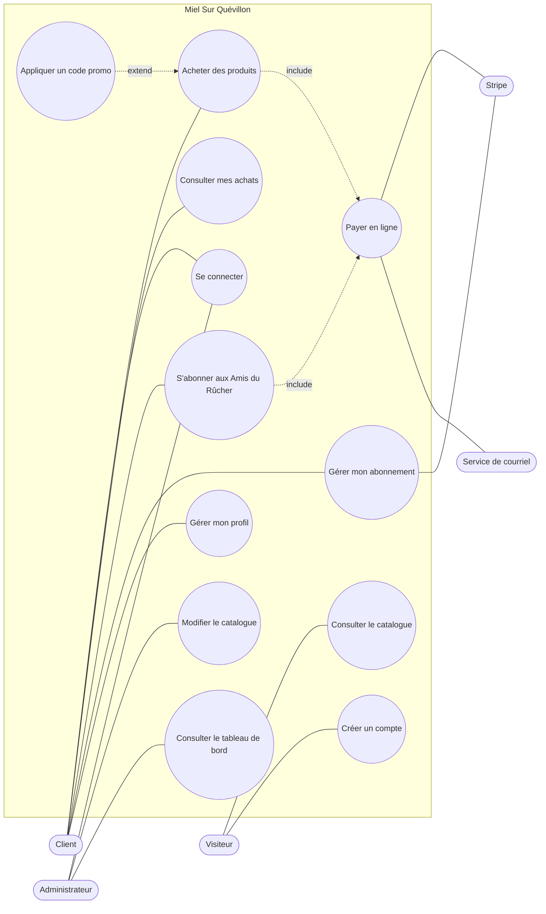
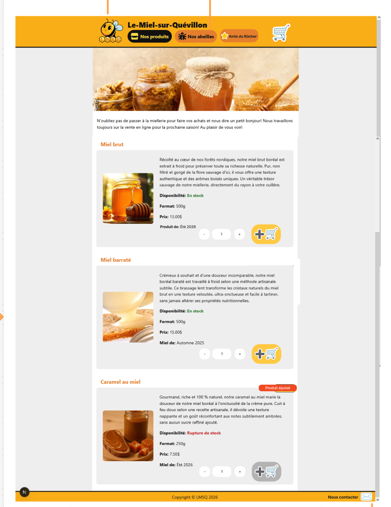
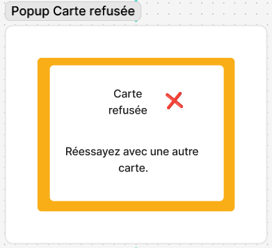
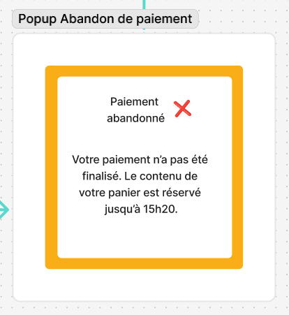

# Cahier des charges — LeMiel-sur-Quévillon

**Plateforme de vente en ligne des produits de la miellerie et d'abonnement « Amis du Rûcher »**

| | |
|---|---|
| Cours | 420-951-MA Applications Web transactionnelles — groupe 25604 |
| Document | Laboratoire 1 |
| Version | 1.1 |
| Option | B — nouveau projet |
| Équipe | 3 membres (Mathieu Gosselin, Francis Boisvert, Clément Laflamme) |
| Modèle de paiement | Hybride : paiement unique (produits du miel) **et** abonnement mensuel (Amis du Rûcher) |
| Stack | Next.js (App Router, TypeScript), Prisma, PostgreSQL (Neon), Clerk, Stripe, Zod, Vitest |

## Historique des versions

| Version | Moment | Modifications |
|---|---|---|
| 1.0 | Semaine 2, partie 2 | Périmètre, cas d'utilisation, user stories et critères, règles métier, exigences non fonctionnelles, diagrammes, maquettes, planification. |
| 1.1 | Semaine 3 | Modèle de données (sections 9.1 à 9.4, `docs/classes.md`, `prisma/schema.prisma`). Compte obligatoire pour acheter. Retrait des remboursements. Adaptation des sections reprises du gabarit (billets, événements, plan Pro) aux produits du miel. |

---

## 1. Contexte et vision

### 1.1 Le problème

Le client aimerait centraliser les commandes pour que les clients cessent d'approcher les bénévoles sur Facebook afin d'obtenir du miel. Il s'agit d'une mielerie a but non lucratif.

- un vente en quantité limitée annoncée sur Facebook à tout le monde en même temps et un décompte papier du stock pour valider la disponibilité;
- des virements Interac ou de l'argent comptant à récolter auprès des clients à la livraison;
- un suivi chaotique du nombre de produits encore disponibles;

Résultat : les bénévoles reçoivent des dizaines de demandes d'inconnus qui cherchent à obtenir les produits de la saison qu'ils doivent traiter pour assurer la vente du miel. Ces mêmes bénévoles doivent ensuite communiquer entre eux pour s'assurer que la personne qui gère le stock ait l'information sur les quantités restantes. Un bénévole en particulier s'occupe des finances et doit démêler les ventes afin de connaître exactement combien d'argent la vente de miel a rapportée dans la saison.

### 1.2 La vision : Why, How, What

| | |
|---|---|
| **Why** | Simplifier la gestion des stocks et des ventes d'un OBNL auprès de la population locale. |
| **How** | En developpant une plateforme de gestion de commandes et de paiements en ligne. |
| **What** | Un site web transactionnel donnant la possibilitée de commander des produits du miel et de les payer en ligne ainsi qu'une offre d'abonnement mensuel pour soutenir l'organisme dans sa mission et avoir accès à des avantages|

### 1.3 Objectifs du projet

1. Permettre à un client d'acheter le miel de la mielerie en ligne.
2. Permettre aux bénévoles d'inscrire les produits et leur quantité sur le site afin d'écouler les stocks sans voir de gestion d'inventaire manuelle à faire.
3. Garantir qu'aucun produit écoulé n'est vendu à un client.
4. Générer automatiquement les factures pour les clients.
5. Valider que le client a une adresse valide à Lebel-sur-Quévillon afin de pouvoir effectuer la livraison des produits.
6. Financer l'OBNL via une inscription payante et récurente aux "Amis du rûcher", donnant accès à des bonus aux abonnés.

### 1.4 Analyse de la concurrence

| Solution | Forces | Faiblesses pour notre public |
|---|---|---|
| Épiceries | Disponibilité et prix compétitif | Sont des produits génériques disponibles partout en province, notre produit est local. |
| Mieleries les plus proches  | Vente en ligne et dans certains magasins de la région. Goûts différents de nos miels. | Notre produit est local, c'est le seul miel produit à 100km à la ronde. |

**Positionnement de LeMiel-sur-Quévillon :** Notre plateforme de vente en ligne existe pour écouler notre stock de produits auprès de la clientèle locale qui correspond à la vaste majorité de nos clients.

### 1.5 Public cible

| Segment | Qui | Ce qu'il paie |
|---|---|---|
| Bénévoles | Les apiculteurs bénévoles de l'organisation (environ 10 personnes) | Ne paient pas pour les fonctionnalités administratives. |
| Clients | Les clients de LeMiel-sur-Quévillon, principalement des citoyens de Lebel-sur-Quévillon. | Le prix unitaires des produits selon leur achat (de 5.00$ à 20.00$) et/ou un abonnement mensuel aux "Amis du rûcher" |

**Marché initial :** Les clients de LeMiel-sur-Quévillon, principalement des citoyens de Lebel-sur-Quévillon au Québec. L'organisme n'atteignant pas les 30000$ de vente brut par année, il n'est pas nécessaire de charger les taxes fédérales et provinciales aux clients. L'argent est en devises canadiennes.

---

## 2. Analyse

### 2.1 Analyse SWOT

| | Positif | Négatif |
|---|---|---|
| **Interne** | **Forces** — Excellente connaissance du produit à vendre · Notre capacité organisationnelle nous permet de livrer un produit bien structuré et bien pensé · Le site va vite au but, on ajoute des produits, on les achètent, pas de tracas inutiles · Tarification transparente et prévisible. | **Faiblesses** — Requiert une plateforme de paiements avec laquelle nous avons peu d'expérience · Petite équipe technique de 3 personnes · Solution adaptée aux besoins très spécifiques d'un seul client. |
| **Externe** | **Opportunités** — La mouvance "Acheter local" pousse les gens et les organisations à chercher des produits locaux. | **Menaces** — Loi 25, données personnelles des clients. · Réticence des clients à utiliser le site · Impossible d'expédier les commandes par la poste, les clients doivent être locaux pour le moment · Les coûts d'opérations du site doivent être le plus bas possible (idéallement nuls). |

**Conséquences pour le projet :** 
- Loi 25 -> Les données des utilisateurs seront protégées et l'utilisateur pourra demander la suppression de ses informations. ENF-05
- Expéditions -> Lors d'un paiement, il faudra s'assurer que la vente est faite à quelqu'un avec une adresse de Lebel-sur-Quévillon et que ses informations de contact sont valides afin qu'un bénévole puisse assurer la livraison. ENF-01

### 2.2 Personas

#### Lynda, 66 ans — cliente retraitée

| | |
|---|---|
| Profil | Lynda est à la retraite, ses enfants son adultes, elle était infirmière et vit très bien de son fond de pension. |
| Objectifs | Lynda veut s'informer de la vente de miel de la miellerie locale, acheter des pots de miel et peut-être quelques produits transformés si quelque chose pique sa curiosité pour faire des cadeaux. |
| Irritants | Lynda a un vieil ordinateur qu'elle sort de temps en temps mais fait la majorité de son commerce en ligne sur son téléphone. Elle craint que les produits qu'elle commande en ligne ne soient pas comme représentés ou pire encore, la fraude. |
| Comportements | Lynda prend ses nouvelles sur Facebook ou de ses amies du village, c'est par la page Facebook qu'elle a appris que la dernière récolte avait été empottée récemment. |
| Ce qui ferait fuir | Une création de compte longue ou compliquée : Lynda veut simplement acheter son miel. L'inscription doit se faire en quelques champs (ou avec son compte Google). Un site louche la ferait aussi renoncer à son achat. |
| Ce qui rassure | Lynda aime quand les prix sont clairs et qu'elle a une facture pour ses achats. Elle est aussi rassurée de pouvoir entrer en communication avec les apiculteurs au besoin. |
| Qui paie ? | Elle-même, par carte de crédit |
| Modèle | **Achat unique** de produits selon son besoin du moment |

#### Jimmy, 40 ans — client fonctionnaire dans un ministère

| | |
|---|---|
| Profil | Jimmy a un bon poste dans un ministère, il est père de famille et a un horaire chargé. |
| Objectifs | Jimmy connaît bien un des apiculteurs et passe par lui personnellement pour acheter son miel. Il est politisé et à sa communauté à coeur. Il a appris qu'il pouvait être un "Ami du rûcher" et veut s'inscrire pour encouragé cette initiative locale. Il pense continuer d'acheter son miel en personne à son ami. |
| Irritants | Il est frustré par les choses mal faites qui fonctionnent mal ou sont lentes.  |
| Comportements | Est très à l'aise avec les technologies modernes. |
| Ce qui ferait fuir | Jimmy est très occupé, il n'a pas le temps d'attendre, si le site est lent il risque de le fermer et de s'occuper d'autres choses avant de compléter sa transaction |
| Ce qui rassure | Jimmy sait qu'une page https:// indique la sécurité. |
| Qui paie ? | Lui-même, en ligne par carte de crédit. |
| Modèle | **Abonnement** (paiement mensuel). |

#### Louise, 38 ans — apicultrice responsable des finances

| | |
|---|---|
| Profil | Louise est impliquée dans plusieurs commités en lien avec l'environnement, elle a une vie remplie par son travail, sa famille et ses activités. Elle oublie parfois de mettre à jour les documents du comité. |
| Objectifs | Louise veut faire profiter à tout le monde de Lebel-sur-Quévillon du miel local en le vendant aux citoyens pour financer les opérations de la mielerie. |
| Irritants | Elle déteste dépenser, surtout pour du neuf ou des choses inutiles.  |
| Comportements | Louise gère ses différents comités par groupes Facebook et discussions Messenger. Elle est bien informée et impliquée dans la communauté et sait naviguer la bureaucratie pour trouver du financement pour les organismes dans lesquels elle s'implique. Elle fait parfois des achats au nom d'autres comités.  |
| Ce qui ferait fuir | Si la plateforme n'offre pas un avantage clair dans la gestion de l'inventaire et des paiements. |
| Ce qui rassure | Des frais récurrents très bas ou mieux encore inexistants. |
| Qui paie ? | Elle-même, par carte de crédit. Si l'achat est pour un comité, elle a besoin d'une facture détaillée. |
| Modèle | **Achat unique** de produits selon son besoin du moment. |

### 2.3 Les 7 P

| P | LeMiel-sur-Quévillon |
|---|---|
| Produit | Nous offrons une plateforme pour écouler le stock de la mielerie qui gère les commandes automatiquement sans l'intervention des bénévoles. |
| Prix | Les tarifs sont déterminés par la mielerie, selon les produits à vendre. Le prix d'un abonnement mensuel est bas puisqu'on le considère comme un "don" qui donne quelques avantages. |
| Place | Le produit est un site web, accessible sur desktop d'abord et mobile ensuite. |
| Promotion | Les activités de la mielerie sont suivies principalement sur Facebook, c'est là qu'à chaque publication on va mentionner le site web et diriger les gens là pour l'achat du miel. |
| Personnes | Notre équipe de développement a à coeur de livrer un produit sans casse-tête pour l'OBNL. |
| Processus | Lynda arriver sur la page d'accueil -> Page de produits -> Découvre et ajoute des produits à son panier (connexion ou création de compte demandée à ce moment) -> Page panier -> Voit son panier, le montant final détaillé à payer, choisit son adresse de livraison et termine le paiement. -> Son achat est confirmé par un pop-up puis elle est ramenée à la page des produits. Un email de confirmation lui est également envoyé. |
| Preuve physique | Design soigné, HTTPS, fonctionnalités sécurisantes de Stripe (s'il y en a), email de confirmation après un achat, pop-up de confirmation après un achat. |

> **Décision**: Les produits à vendre étant physiques et ponctuels, la meilleure façon d'inclure un paiement récurrent pour nous est de créer un abonnement mensuel très abordable et caritatif afin de soutenir les activités de la mielerie pour qui chaque dollar de profit est réinvestit dans la saison suivante. 

---

## 3. Modèle de paiement

LeMiel-sur-Quévillon utilise un modèle **hybride**, obligatoire pour une équipe de trois : un **abonnement mensuel** payé par clients désireux de soutenir la mielerie, et un **paiement unique** pour chaque transaction lors de l'achat de produit physique.

### 3.1 Détails de l'abonnement

| | Les Amis du Rûcher |
|---|---|
| Prix | **3$ par mois**, avant taxes |
| Essai | Aucun essai, le produit ne le justifie pas |
| Donne accès à | Des événements, des codes promo, des tirages, des sneak-peaks, peut-être un jour une prévente |
| Modèle de facturation | Mensuel |

**Pour les clients:** Un compte est obligatoire pour acheter ou s'abonner (authentification par Clerk). Le compte conserve les informations de contact et une ou plusieurs adresses de livraison. Les produits physiques sont vendu à l'unité (**paiement unique**), au prix fixé par l'organisme.

### 3.2 Justification du prix de l'abonnement "Amis du Rûcher"

- **Par les coûts de transaction(plancher) :** L'abonnement doit au minimum couvrir ses frais et rapporter un petit profit à l'organisme (environ 2,9 % + 0,30\$, soit un coût à la transaction d'environ 0,39\$ sur 3,00\$, ce qui laisse 2,61\$ à l'organisme par abonné mensuel).
- **Par les demandes de dons similaires (repère) :** D'autres organismes demandent à leur usagers ou supporteurs de souscrire à un don récurrent équivalent à un café par mois (ex: Wikimedia).
- **Par la valeur perçue (plafond) :** La clientèle la plus motivée par la réussite de cette OBNL communautaire aura en plus du sentiment de satisfaction accès à des bonus exclusifs à déterminer.

### 3.3 Taxes : exemples de calcul

Comme l'organisme fait moins de 30000$ brut de ventes par année il n'est pas nécessaire de charger les taxes aux clients (RM-17). Vu les stocks limités, il est peu probable que ce seuil soit atteint, mais le système applique la règle au cas où. Si le total des ventes venait à excéder ce montant, il faudra alors afficher et appliquer les taxes comme suit:
Les prix sont affichés **avant taxes**. La TPS (5 %) et la TVQ (9,975 %) sont calculées sur chaque ligne de commande, sur le montant après rabais s'il en existe un, **en cents**, et arrondies taxe par taxe (RM-13).

De plus certains produits de la mielerie ne sont pas taxables puisqu'ils sont considérés comme de l'épicerie, pour ceux-ci la TPS et le TVQ seront toujours de 0$. (RM-16)

| Achat | Taxable? | Sous-total | TPS | TVQ | Total |
|---|---|---:|---:|---:|---:|
| Pot de miel de 1kg | Non taxable | 20,00 $ | 0,00$ | 0,00 $ | **20,00 $** |
| Bonbons au miel | Taxable | 8,00 $ | 0,40 $ | 0,80 $ | **9,20 $** |
| Abonnement "Amis du Rûcher" | Taxable | 3,00 $ | 0,15 $ | 0,30 $ | **3,45 $** |

Détail de l'achat de bonbons au miel : 800 × 0,09975 = 79,8 cents, arrondi à 80 cents.

### 3.4 Les cas de paiement

| Cas | Ce que voit l'utilisateur | Ce que fait le système |
|---|---|---|
| Achat d'un pot de miel (achat unique) | Connexion, choix d'une adresse de livraison (validation d'une adresse de Lebel-sur-Quévillon), récapitulatif avec taxes (les taxes valent 0$ car c'est un produit d'épicerie), redirection vers Stripe, page de confirmation, reçu par courriel. | Commande `EN_ATTENTE`, produit réservé 30 min ; à la réception du webhook : commande `PAYEE`, commande confirmée. |
| Paiement refusé | Message clair (« carte refusée », « fonds insuffisants ») et retour au récapitulatif. | Aucune commande payée ; le pot reste réservé jusqu'à l'expiration de la session, puis est libéré. |
| Abonnement (récurrence mensuelle) | Connexion, récapitulatif avec taxes, redirection vers Stripe, page de confirmation, reçu par courriel. Aucune période d'essai pour ce produit, carte enregistrée chez Stripe, aucune limite de disponibilité sur les abonnements. | Abonnement `ACTIF` au premier paiement. |
| Renouvellement | Facture mensuelle par courriel. | Webhook `invoice.paid` : prolongation de la période. |
| Échec de renouvellement | Courriel « mettez à jour votre carte » et un accès sur le site pour accéder au portail de Stripe. | Statut `EN_RETARD`, maintient du statut d'Ami du Rûcher pendant 7 jours (période de grâce), relances automatiques de Stripe. |
| Annulation | Bouton « Gérer mon abonnement » (portail Stripe) ; le statut d'Ami du Rûcher est conservé jusqu'à la fin de la période payée. | Webhook `customer.subscription.updated` : `annuleFinPeriode` = vrai ; à la fin de la période, webhook `customer.subscription.deleted` : statut `ANNULE`. Aucun remboursement de la période en cours. |
| Remboursement | Aucun remboursement n'est offert sur le site. Un problème avec une commande est réglé directement avec un bénévole, en dehors du système. | Si un bénévole rembourse tout de même manuellement dans le tableau de bord Stripe, le webhook `charge.refunded` passe la commande à `REMBOURSEE` (pour des statistiques justes) ; les produits ne reviennent pas en stock. |

### 3.5 Événements Stripe écoutés par le serveur

| Événement | Réaction de LeMiel-sur-Quévillon |
|---|---|
| `checkout.session.completed` | Produits : commande `PAYEE`, stock confirmé, reçu au client et copie au bénévole livreur. Abonnement : création ou mise à jour de l'abonnement en BD. |
| `checkout.session.expired` | Commande `ANNULEE`, produits remis en stock. |
| `invoice.paid` | Abonnement `ACTIF`, nouvelle date de fin de période. |
| `invoice.payment_failed` | Abonnement `EN_RETARD`, période de grâce, courriel à l'abonné. |
| `customer.subscription.updated` | Synchronisation du statut et de `annuleFinPeriode`. |
| `customer.subscription.deleted` | Abonnement `ANNULE`, le statut d'Ami du Rûcher est retiré |
| `charge.refunded` | Commande `REMBOURSEE` (remboursement manuel seulement), produits ne sont pas remis en stock. |

> **Hypothèse de la version 1 : encaissement des ventes** En version 1, l'argent des ventes est encaissé par le compte Stripe de LeMiel-sur-Quévillon moins les frais Stripe.

---

## 4. Périmètre

| Inclus (cette session) | Exclu (version 2 ou jamais) |
|---|---|
| Catalogue des produits disponibles | Application mobile native |
| Création de compte et connexion (Clerk) | Prévente ouverte aux Amis du Rûcher |
| Inscription à un plan mensuel | Achat sans compte |
| Validation d'adresse pour la livraison | Abonnement annuel (plutôt que mensuel) |
| Achat de produits physiques | Interface en anglais |
| Paiement Stripe Checkout (paiement unique) | Demandes et approbation de remboursement |
| Interface responsive, en français | |
| Webhooks, reçus et factures par courriel | |
| Statistiques de ventes pour l'année | |
| Application dynamique des taxes selon le chiffre d'affaire de l'organisme | |
| Espace administrateur à même le site pour créer des produits et gérer l'inventaire | |

---

## 5. Acteurs et cas d'utilisation

### 5.1 Acteurs

| Acteur | Type | Rôle |
|---|---|---|
| Visiteur | Principal | Personne non connectée qui consulte le site et peut créer un compte. |
| Client | Principal | Personne connectée faisant une transaction, que ce soit un abonnement ou un achat unique. Achète, reçoit une facture, consulte ses achats. |
| Administrateur | Principal | Bénévole connecté qui crée et publie des produits et suit les revenus. |
| Stripe | Secondaire (système) | Encaisse les paiements, gère les abonnements et le portail client ; envoie les webhooks. |
| Service de courriel | Secondaire (système) | Envoie les reçus, les factures et les avis d'échec de paiement. Envoie les communications aux membres abonnés aux Amis du Rûcher |

### 5.2 Cas d'utilisation

| ID | Cas d'utilisation | Acteur principal | Acteurs secondaires | Relations |
|---|---|---|---|---|
| UC-01 | Consulter le catalogue | Visiteur | — | — |
| UC-02 | Acheter des produits | Client | Stripe, courriel | «include» UC-09 |
| UC-04 | Consulter mes achats | Client | — | — |
| UC-05 | Se connecter | Utilisateur | — | — |
| UC-06 | Créer et modifier le catalogue | Administrateur | — | — |
| UC-07 | S'abonner aux Amis du Rûcher | Client | Stripe, courriel | «include» UC-09 |
| UC-08 | Gérer mon abonnement | Client | Stripe | — |
| UC-09 | Payer en ligne | (inclus) | Stripe, courriel | — |
| UC-11 | Appliquer un code promo | Client | — | «extend» UC-02 |
| UC-12 | Consulter le tableau de bord | Administrateur | — | — |
| UC-13 | Créer un compte | Visiteur | — | — |
| UC-14 | Gérer mon profil (informations, adresses, suppression des données) | Client | — | — |

UC-03 (Demander un remboursement) et UC-10 (Rembourser un client) ont été retirés en version 1.1 : aucun remboursement n'est offert sur le site.

**Généralisation :** Client et Administrateur sont des sortes d'Utilisateur et héritent de UC-05 « Se connecter ».

### 5.3 Description textuelle — UC-02 Acheter des produits

| | |
|---|---|
| Acteur principal | Client |
| Acteurs secondaires | Stripe, service de courriel |
| Préconditions | Le client est connecté ; son panier contient au moins un produit publié et en stock ; il a une adresse de livraison à Lebel-sur-Quévillon. |
| Postconditions | La commande est `PAYEE`, les quantités sont retirées du stock, le reçu est envoyé au client et une copie au bénévole livreur. |

**Scénario nominal**
1. Le client ouvre son panier et choisit son adresse de livraison.
2. Le système vérifie le stock de chaque produit et affiche le récapitulatif : sous-total, TPS, TVQ, total.
3. Le client confirme ; le système crée la commande `EN_ATTENTE`, réserve les quantités et redirige vers Stripe.
4. Stripe autorise le paiement (avec 3-D Secure si la banque l'exige).
5. Le système reçoit le webhook signé, marque la commande `PAYEE` et vide le panier.
6. Le système envoie le reçu par courriel (client et bénévole livreur) et affiche la page de confirmation.

**Scénarios alternatifs**
- **1a.** Adresse hors de Lebel-sur-Quévillon : la commande est refusée avec le message « Seules les commandes locales sont acceptées » (RM-03). Fin.
- **2a.** Stock insuffisant : le système affiche « Épuisé » ou la quantité maximale. Fin.
- **2b.** Code promo saisi : le système applique le rabais s'il est valide (UC-11).
- **4a.** Carte refusée : message clair, retour au récapitulatif ; produits remis en stock à l'expiration (RM-02).
- **4b.** Le client abandonne : la session expire, la commande passe à `ANNULEE`, produits remis en stock.
- **5a.** Webhook reçu deux fois : le second est ignoré (RM-14).

### 5.4 Description textuelle — UC-07 S'abonner aux Amis du Rûcher

| | |
|---|---|
| Acteur principal | Client |
| Acteurs secondaires | Stripe, service de courriel |
| Préconditions | Le client est connecté et n'a pas d'abonnement actif. |
| Postconditions | L'abonnement est `ACTIF` ; le client est un Ami du Rûcher et reçoit les communications réservées. |

**Scénario nominal**
1. Le client consulte la page des Amis du Rûcher et clique sur « Devenir un Ami du Rûcher ».
2. Le système crée une session Stripe en mode abonnement (3,00 $ par mois, sans essai).
3. Le client saisit sa carte chez Stripe.
4. Le système reçoit le webhook `checkout.session.completed` et enregistre l'abonnement.
5. Le webhook `invoice.paid` passe l'abonnement à `ACTIF` ; le reçu est envoyé par courriel.

**Scénarios alternatifs**
- **1a.** Le client a déjà un abonnement actif : le bouton affiche « Gérer mon abonnement » et mène au portail Stripe (UC-08).
- **3a.** Carte refusée : retour à la page des Amis du Rûcher avec un message ; aucun abonnement créé.
- **5a.** Renouvellement refusé : statut `EN_RETARD`, période de grâce de 7 jours (RM-05).
- **\*a.** Le client annule : le statut d'Ami du Rûcher est conservé jusqu'à la fin de la période payée (RM-09).

---

## 6. User stories

### 6.1 Backlog priorisé (MoSCoW)

Tailles : **S** (petite, moins d'une journée), **M** (moyenne, deux ou trois jours), **L** (grande, à découper si possible).

| ID | En tant que | Je veux… afin de… | Priorité | Taille |
|---|---|---|---|---|
| US-01 | visiteur | voir les produits disponibles avec leur prix avant taxes, afin de décider si je veux acheter. | Must | S |
| US-02 | client | acheter un item physique et payer en ligne avec mon compte, afin de recevoir mes produits sans passer par un bénévole. | Must | L |
| US-03 | client | voir le total taxes comprises avant de payer, afin de ne pas avoir de surprise. | Must | S |
| US-04 | client | recevoir un reçu détaillé par courriel, afin de me faire rembourser un achat fait pour mon organisation. | Must | S |
| US-05 | client | voir un message clair si ma carte est refusée, afin de réessayer avec une autre carte. | Must | S |
| US-06 | administrateur | valider que le client a une adresse de Lebel-sur-Quévillon, afin de pouvoir lui livrer un produit physique. | Must | S |
| US-07 | administrateur | qu'une copie de la facture soit envoyée à une adresse email consultée par le bénévole en charge des livraisons, afin qu'il puisse effectuer la livraison des produits. | Must | S |
| US-08 | administrateur | créer et publier des produits avec leur nom, quantité disponible, prix, format, statut taxable, description et autres informations, afin de pouvoir les rendre disponibles à la vente. | Must | M |
| US-09 | administrateur | catégoriser mes produits selon leur statut de taxation, afin de ne pas charger les taxes sur les produits d'épicerie. | Must | S |
| US-10 | administrateur | que la vente d'un item soit bloquée si le produit n'est plus en stock, afin d'éviter des ventes qui ne pourront pas être livrées. | Must | S |
| US-11 | client | m'abonner au plan "Amis du Rûcher", afin de soutenir un projet local. | Must | M |
| US-12 | client | gérer mon abonnement (carte, annulation) dans un portail (Stripe), afin de ne pas écrire au support. | Must | S |
| US-13 | client | être averti quand mon paiement mensuel échoue, afin de mettre ma carte à jour à temps. | Must | S |
| US-24 | visiteur | créer un compte en quelques champs ou avec mon compte Google, afin de pouvoir acheter ou m'abonner sans démarche compliquée. | Must | S |
| US-25 | client | gérer mes adresses de livraison (ajouter, modifier, supprimer, choisir celle par défaut), afin de ne pas les ressaisir à chaque commande. | Must | S |
| US-16 | administrateur | voir les revenus de l'année combinés et par produit | Should | M |
| US-17 | administrateur | que le premier 30000$ de ventes brut exclue les taxes (valent 0$). | Should | M |
| US-26 | client | consulter et modifier mes informations personnelles dans un espace client, afin que les bénévoles puissent me joindre pour la livraison. | Should | S |
| US-27 | client | consulter l'historique de mes commandes et le détail de chacune, afin de retrouver un achat ou de fournir une pièce justificative à mon organisation. | Should | M |
| US-28 | client | demander la suppression de mes données personnelles, afin d'exercer les droits que me donne la Loi 25. | Should | M |
| US-18 | client | recevoir des communications et des offres exclusives en tant qu'Ami du Rûcher, afin de retirer une certaine valeur de mon abonnement mensuel. | Could | M |
| US-19 | client | appliquer une promotion sur ma commande, afin de profiter d'un rabais offert par mon statut d'Ami du Rûcher. | Could | M |
| US-14 | client | demander un remboursement, afin de récupérer mon argent si il y a eu un problème avec ma commande. | Won't | — |
| US-15 | administrateur | approuver un remboursement, afin de régler une situation problématique avec une commande. | Won't | — |
| US-20 | client | payer un abonnement annuel, afin de ne faire qu'un paiement. | Won't | — |
| US-21 | client | utiliser une application mobile native, afin d'avoir une meilleure expérience sur téléphone. | Won't | — |
| US-22 | administrateur | ouvrir la vente de certains produits aux Amis du Rûcher en primeur (prévente), afin de donner une valeur supplémentaire à leur abonnement | Won't | — |
| US-23 | administrateur | une version anglais du site, afin de servir d'éventuels clients anglophones | Won't | — |

Les **Must** (US-01 à US-13, US-24 et US-25) représentent environ 60 % de l'effort estimé ; ils couvrent les deux modèles de paiement.

### 6.2 Critères d'acceptation

**US-01 — Voir les produits disponibles avec leur prix avant taxes**
1. **Étant donné** des produits sont disponibles pour la vente, **quand** j'ouvre le catalogue sur le site, **alors** je vois les informations des produits: leur nom, description, prix unitaire avant taxes, format, quantité, saison et année.
2. **Étant donné** un produit qui n'est plus en-stock depuis 30 jours et moins, **quand** j'ouvre le catalogue, **alors** il apparait avec une mention "Produit épuisé" et il est impossible de l'ajouter au panier.
3. **Étant donné** un produit qui n'est plus en-stock depuis plus de 30 jours, **quand** j'ouvre le catalogue, **alors** il n'apparaît pas.
4. **Étant donné** un produit en brouillon, **quand** j'ouvre le catalogue, **alors** il n'apparaît pas.

**US-02 — Acheter un item physique et payer en ligne avec mon compte**
1. **Étant donné** que je suis connecté et que mon panier contient des produits, **quand** je paie avec une carte valide, **alors** ma commande passe à « payée », les produits sont retirés du stock et je suis redirigé vers la page de confirmation.
2. **Étant donné** qu'il reste 1 produit, **quand** deux clients paient en même temps, **alors** un seul obtient le produit et l'autre voit « Produit épuisé, désolé » avant d'être débité.
3. **Étant donné** que j'ai commencé un paiement, **quand** j'abandonne pendant plus de 30 minutes, **alors** ma commande est annulée et les produits sont remis en stock.
4. **Étant donné** un paiement réussi, **quand** Stripe envoie deux fois le même webhook, **alors** une seule commande est payée et un seul reçu est envoyé.
5. **Étant donné** que je ne suis pas connecté, **quand** je veux ajouter un produit au panier, **alors** je suis invité à me connecter ou à créer un compte.

**US-03 — Voir le total taxes comprises avant de payer**
1. **Étant donné** un produit taxable à 8,00 $, **quand** j'affiche le récapitulatif, **alors** je vois TPS 0,40 $, TVQ 0,80 $ et total 9,20 $.
2. **Étant donné** un produit exempt de taxes à 20,00 $, **quand** j'affiche le récapitulatif, **alors** je vois TPS 0,00 $, TVQ 0,00 $ et total 20,00 $.
3. **Étant donné** un récapitulatif affiché, **quand** j'arrive chez Stripe, **alors** le montant est exactement le même.
4. **Étant donné** que le total brut des ventes pour l'année est égal ou inférieur à 30000$, **quand** j'affiche le récapitulatif **alors** les taxes ne sont pas chargée au client, la TPS et la TVQ affichent tous deux 0,00 $.

**US-04 —  Recevoir un reçu détaillé par courriel**
1. **Étant donné** une commande payée, **quand** le webhook de paiement est traité, **alors** je reçois un courriel avec le numéro de commande, le détail des produits achetés, la TPS, la TVQ, le total et l'adresse de livraison.
2. **Étant donné** un webhook reçu deux fois, **quand** il est traité, **alors** je ne reçois qu'un seul reçu.

**US-05 — Message clair si la carte est refusée**
1. **Étant donné** la carte de test `4000 0000 0000 9995`, **quand** je paie, **alors** je vois « Fonds insuffisants, essayez une autre carte » et aucune commande n'est payée.
2. **Étant donné** la carte de test `4000 0027 6000 3184`, **quand** j'échoue l'authentification, **alors** je reviens au récapitulatif avec un message.

**US-06 - Valider que le client a une adresse de Lebel-sur-Quévillon**
1. **Étant donné** le client entre une adresse de livraison à Lebel-sur-Quévillon avec le code postal J0Y 1X0 **quand** il passe une commande  **alors** la commande est valide et le client peut poursuivre son achat.
2. **Étant donné** le client entre une adresse de livraison qui n'est pas à Lebel-sur-Quévillon **quand** il passe une commande  **alors** la commande est refusée et un message "Seules les commandes locales sont acceptés, nous sommes désolés des inconvénients.".
3. **Étant donné** le client entre des informations de livraison sans majuscules ou sans espaces (ex: j0y1x0) **quand** il passe une commande  **alors** la commande est valide et le client peut poursuivre son achat.

**US-07 — Une copie de la facture est envoyée à une adresse email consultée par le bénévole en charge des livraisons**
1. **Étant donné** une commande payée, **quand** le webhook de paiement est traité, **alors** le bénévole en charge reçoit un courriel avec le numéro de commande, le détail des produits achetés, la TPS, la TVQ, le total et l'adresse de livraison.
2. **Étant donné** un webhook reçu deux fois, **quand** il est traité, **alors** le bénévole reçoit un seul reçu.

**US-08 — Créer et publier des produits**
1. **Étant donné** que je suis administrateur, **quand** je crée un produit avec un nom, quantité disponible, prix, format, statut taxable, description, saison, année et photo  **alors** il est enregistré en brouillon et je peux le publier.
2. **Étant donné** que je suis administrateur, **quand** je consulte ma liste de produits, je peux activer la vente d'un produit brouillon **alors** son statut devient "en stock", il est affiché dans le catalogue et peut être acheté par les clients.
3. **Étant donné** une quantité de stock de 0 ou moins, **quand** j'enregistre le nouveau produit, **alors** un message indique le champ invalide.
4. **Étant donné** un statut taxable non spécifié, **quand** j'enregistre le nouveau produit, **alors** l'item est taxable par défaut.
5. **Étant donné** un nom vide, **quand** j'enregistre le nouveau produit, **alors** un message indique le champ invalide.
6. **Étant donné** une description vide, **quand** j'enregistre le nouveau produit, **alors** un message indique le champ invalide.
7. **Étant donné** un format vide, **quand** j'enregistre le nouveau produit, **alors** un message indique le champ invalide.
8. **Étant donné** que je suis connecté comme client, **quand** j'essaie d'accéder à l'espace administrateur, **alors** l'accès est refusé (RM-08).

**US-09 — Catégoriser mes produits selon leur statut de taxation**
1. **Étant donné** un produit d'épicerie comme un pot de miel à 20,00 $, **quand** il a la statut non taxable  **alors** la TPS et la TVQ sur ce produit est de 0,00 $.
2. **Étant donné** un produit comme des bonbons au miel à 8,00 $, **quand** il a le statut taxable **alors** la TPS est de 0,40 $, et la TVQ de 0,80 $ et total 9,20 $.
   
**US-10 — La vente d'un item soit bloquée si le produit n'est plus en stock**
1. **Étant donné** un produit dont la quantité disponible est de 0 ou moins, **quand** le client visite le catalogue  **alors** Le produit ne peut pas être ajouté au panier, un badge « Épuisé » est affiché.
2. **Étant donné** un produit dont il reste 1 seul exemplaire, **quand** le client tente d'ajouter le produit une seconde fois à son panier **alors** l'ajout au panier est refusé avec un message qui indique que "Le panier ne peut contenir plus d'exemplaires du produit que le stock n'en contient".

**US-11 —  M'abonner au plan "Amis du Rûcher"**
1. **Étant donné** que je suis connecté et que je clique sur « Devenir un Ami du Rûcher », **quand** je m'abonne avec une carte valide, **alors** mon plan est débité et mon compte est ajouté à la liste des "Amis du Rûcher".
2. **Étant donné** que mon compte a déjà un abonnement actif, **quand** j'ouvre la page d'abonnement, **alors** le bouton affiche « Gérer mon abonnement » et envoie au portail Stripe plutôt que de permettre l'inscription.

**US-12 — Gérer mon abonnement**
1. **Étant donné** un abonnement actif, **quand** je clique sur « Gérer mon abonnement », **alors** j'arrive sur le portail client Stripe, où je peux changer ma carte ou annuler.
2. **Étant donné** que j'ai annulé mon abonnement, **quand** une nouvelle promotion est envoyée par l'administrateur avant la fin de ma période payée, **alors** je la reçois encore par email (RM-09).
3. **Étant donné** que j'ai annulé mon abonnement, **quand** la période payée est terminée, **alors** je ne reçois plus les promotions par email.

**US-13 — Être averti d'un échec de paiement mensuel**
1. **Étant donné** un abonnement actif avec la carte `4000 0000 0000 0341`, **quand** le renouvellement échoue, **alors** je reçois un courriel et je garde le statut d'Ami du Rûcher pendant 7 jours.
2. **Étant donné** un abonnement en retard, **quand** je mets ma carte à jour et que le paiement passe, **alors** le statut redevient actif.
3. **Étant donné** un abonnement en retard, **quand** toutes les relances échouent, **alors** mon compte est retiré de la liste des "Amis du Rûcher" et je ne reçois plus d'offres et de communications de la mielerie.

**US-24 — Créer un compte**
1. **Étant donné** que je ne suis pas connecté, **quand** je crée un compte avec mon prénom, mon nom, mon courriel et un mot de passe, **alors** mon compte est créé avec le rôle client et je suis connecté.
2. **Étant donné** que je ne suis pas connecté, **quand** je crée un compte avec Google, **alors** mon prénom, mon nom et mon courriel sont repris de Google et aucun autre champ n'est exigé.
3. **Étant donné** un courriel déjà associé à un compte, **quand** je crée un compte avec ce courriel, **alors** je vois « Un compte existe déjà avec ce courriel » et je suis invité à me connecter.
4. **Étant donné** que j'ai été invité à créer un compte en ajoutant un produit au panier (US-02), **quand** la création est terminée, **alors** je reviens à la page où j'étais.
5. **Étant donné** un nouveau compte créé chez Clerk, **quand** le système enregistre l'utilisateur, **alors** une seule fiche `Utilisateur` est créée (`clerkId` unique), même si l'événement de création est reçu deux fois.

**US-25 — Gérer mes adresses de livraison**
1. **Étant donné** que je suis connecté, **quand** j'ajoute une adresse à Lebel-sur-Quévillon avec le code postal « j0y1x0 », **alors** elle est enregistrée avec le code postal normalisé « J0Y 1X0 » (RM-03).
2. **Étant donné** que je suis connecté, **quand** j'ajoute une adresse hors de Lebel-sur-Quévillon, **alors** elle est refusée avec le message « Seules les commandes locales sont acceptées, nous sommes désolés des inconvénients. »
3. **Étant donné** que je n'ai aucune adresse, **quand** j'ajoute ma première adresse, **alors** elle devient mon adresse par défaut.
4. **Étant donné** plusieurs adresses, **quand** j'en choisis une autre comme adresse par défaut, **alors** l'ancienne ne l'est plus (une seule adresse par défaut).
5. **Étant donné** une adresse par défaut, **quand** j'ouvre mon panier, **alors** elle est présélectionnée comme adresse de livraison.
6. **Étant donné** une adresse utilisée par une commande passée, **quand** je la modifie ou la supprime, **alors** la commande conserve l'adresse copiée au moment de l'achat (RM-07).
7. **Étant donné** l'identifiant d'une adresse d'un autre client, **quand** j'essaie de la consulter, de la modifier ou de la supprimer, **alors** l'action est refusée (RM-08).

**US-16 — Voir les revenus de l'année combinés et par produit**
1. **Étant donné** la fin de l'année 2026, **quand** je sors les statistiques de ventes pour l'année, **alors** je vois un rapport sous forme de liste détaillant sur chaque ligne le nom du produit, son format, le nombre vendu pour l'année, le prix unitaire, le prix total brut de tous les exemplaires vendus, si applicable la TPS et la TVQ appliquée au prix total brut de tous les exemplaires vendus. La dernière ligne donne le total des taxes récoltées pour la TPS et la TVQ ainsi que le total brut de tous les produits vendus dans l'année en dollars.
2. **Étant donné** une année passée, **quand** je choisis l'an 2026, **alors** je vois un rapport pour les ventes faites du 1er janvier 2026 au 31 décembre 2026.
3. **Étant donné** que je choisis l'année 2027, **quand** je choisis une année future, **alors** je vois un message demandant de saisir une année présente ou passée valide.
4. **Étant donné** que je choisi l'année 2022, **quand** je choisis une année passée où le site n'était pas en opération, **alors** je vois un message demandant de saisir une autre année: "Choisissez une année à partir de 2026"
5. **Étant donné** une commande remboursée manuellement dans Stripe, **quand** je sors le rapport, **alors** elle n'est pas comptée dans les ventes.

**US-17 — Le premier 30000$ de ventes brut exclue les taxes**
1. **Étant donné** l'OBNL a vendu 10000 $ brut dans l'année courante avant la transaction, **quand** le récapitulatif du client est affiché **alors** le montant de la TPS et de la TVQ indique 0,00 $ peu importe le statut taxable des items.
2. **Étant donné** l'OBNL a vendu 30000 $ brut dans l'année courante avant la transaction, **quand** le récapitulatif du client est affiché **alors** le montant de la TPS et de la TVQ est calculé et affiché, selon le statut taxable des items dans son panier.
3. **Étant donné** l'OBNL a vendu 29999 $ brut dans l'année courante avant la transaction, **quand** la commande du client fait excéder la limite de 30000 $ après sa transaction **alors** le montant de la TPS et de la TVQ est calculé et affiché, selon le statut taxable des items dans son panier.

**US-26 — Consulter et modifier mes informations personnelles**
1. **Étant donné** que je suis connecté, **quand** j'ouvre « Mon compte », **alors** je vois mes informations personnelles (prénom, nom, courriel, téléphone), mes adresses de livraison, un lien vers l'historique de mes commandes et l'état de mon abonnement aux Amis du Rûcher (avec le bouton « Gérer mon abonnement » ou « Devenir un Ami du Rûcher »).
2. **Étant donné** que je suis connecté, **quand** je modifie mon prénom, mon nom ou mon téléphone, **alors** les changements sont enregistrés et utilisés pour mes prochaines commandes ; mes commandes passées ne changent pas (RM-07).
3. **Étant donné** un prénom ou un nom vide, **quand** j'enregistre, **alors** un message indique le champ invalide.
4. **Étant donné** un numéro de téléphone qui ne contient pas 10 chiffres, **quand** j'enregistre, **alors** un message indique le champ invalide.
5. **Étant donné** que je change mon courriel, **quand** j'enregistre, **alors** un code de vérification est envoyé à la nouvelle adresse (Clerk) et le courriel n'est remplacé qu'après la vérification.
6. **Étant donné** que je ne suis pas connecté, **quand** j'ouvre « Mon compte », **alors** je suis redirigé vers la page de connexion.

**US-27 — Consulter l'historique de mes commandes**
1. **Étant donné** que j'ai passé des commandes, **quand** j'ouvre « Mes commandes », **alors** je vois toutes mes commandes, de la plus récente à la plus ancienne, avec le numéro, la date, le nombre de produits, le total et le statut.
2. **Étant donné** des commandes en attente, payées, annulées ou remboursées, **quand** j'ouvre « Mes commandes », **alors** chacune apparaît avec un libellé clair de son statut (« En attente de paiement », « Payée », « Annulée — paiement non finalisé », « Remboursée »).
3. **Étant donné** une commande payée, **quand** j'en ouvre le détail, **alors** je vois chaque produit (nom, format, saison, année, quantité, prix unitaire), le rabais, la TPS, la TVQ, le total et l'adresse de livraison, tels qu'au moment de l'achat, même si le produit a été modifié depuis (RM-07).
4. **Étant donné** que je n'ai passé aucune commande, **quand** j'ouvre « Mes commandes », **alors** je vois « Vous n'avez pas encore passé de commande » et un lien vers le catalogue.
5. **Étant donné** le numéro d'une commande d'un autre client, **quand** j'essaie d'en ouvrir le détail, **alors** l'accès est refusé (RM-08).

**US-28 — Demander la suppression de mes données personnelles**
1. **Étant donné** que je suis connecté, **quand** je demande la suppression de mes données, **alors** un avertissement m'explique que l'action est irréversible et que mes commandes sont conservées pour la comptabilité, et je dois confirmer.
2. **Étant donné** que j'ai confirmé, **quand** la demande est traitée, **alors** mon prénom, mon nom, mon courriel et mon téléphone sont remplacés par des valeurs neutres, mes adresses et mon panier sont supprimés, mon compte Clerk est supprimé, `anonymiseLe` est rempli et je suis déconnecté (ENF-05).
3. **Étant donné** un abonnement aux Amis du Rûcher actif ou en retard, **quand** je confirme la suppression, **alors** l'abonnement est annulé immédiatement chez Stripe, sans remboursement de la période en cours.
4. **Étant donné** un compte anonymisé, **quand** l'administrateur sort le rapport annuel (US-16), **alors** les commandes payées de ce compte sont toujours comptées.

**US-18 — Recevoir des communications et des offres exclusives en tant qu'Ami du Rûcher**
1. **Étant donné** que je suis un membre valide des Amis du Rûcher **quand** une promotion est envoyée par email à la liste des Amis du Rûcher, **alors** je la reçoit par email.
   
**US-19 — Appliquer un code promo**
1. **Étant donné** un code valide de 10% **quand** je l'applique a un produit de 20,00 $ taxable **alors** le récapitulatif affiche le rabais de 2,00 $ et le prix du produit avant taxes 18,00 $ puis applique la TPS et la TVQ ce qui donne 20,70 $.
2. **Étant donné** un code valide de 10% **quand** je l'applique a un produit de 20,00 $ non-taxable **alors** le récapitulatif affiche le rabais de 2,00 $ et le prix du produit avant taxes 18,00 $ puis applique la TPS et la TVQ à 0,00 $ ce qui donne 18,00 $.
3. **Étant donné** un code expiré **quand** j'essai de l'appliquer a un produit **alors** on voit un message "Ce code a expiré" et le prix n'est pas modifié.
4. **Étant donné** un code inexistant **quand** j'essaie d'appliquer a un produit **alors** on voit le message 'code invalide'.
5. **Étant donné** qu'un code est deja appliqué **quand** je le saisis une seconde fois, **alors** le second est refusé (un seul code par commande).
6. **Étant donné** un code dont le nombre maximal d'utilisations est atteint **quand** je l'applique, **alors** on voit un message 'Ce code n'est plus disponible' et le prix ne change pas.
7. **Étant donné** un code réservé aux Amis du Rûcher **quand** je l'applique avec un compte qui n'est pas Ami du Rûcher, **alors** on voit un message 'Seul les Amis du Rûcher peuvent bénéficier de ce code' et le prix ne change pas.
8. **Étant donné** un code réservé aux Amis du Rûcher **quand** je l'applique avec un compte Ami du Rûcher valide, **alors** le rabais est appliqué.

---

## 7. Règles métier

| ID | Règle | Mise en œuvre |
|---|---|---|
| RM-01 | Un produit ne se vend jamais en plus grande quantité que son stock disponible, même en cas d'achats simultanés. | Transaction ACID |
| RM-02 | Les produits d'une commande en attente sont réservés 30 minutes ; ils sont remis en stock si la session de paiement expire ou est abandonnée. | Expiration de session + webhook |
| RM-03 | Une commande n'est acceptée que si l'adresse de livraison est à Lebel-sur-Quévillon (code postal J0Y 1X0, normalisé sans tenir compte de la casse ni des espaces). | Validation serveur (Zod) |
| RM-04 | Aucun remboursement n'est offert sur le site. Un remboursement fait manuellement dans Stripe passe la commande à `REMBOURSEE`, sans remettre les produits en stock. | Webhook `charge.refunded` |
| RM-05 | Un abonnement en retard de paiement garde le statut d'Ami du Rûcher pendant 7 jours (période de grâce). | Logique d'accès |
| RM-06 | Seul un Ami du Rûcher valide (abonnement actif ou en période de grâce) peut utiliser un code promo réservé et recevoir les communications des Amis du Rûcher. | Logique d'accès |
| RM-07 | Le nom, le format, la saison, l'année, le statut de taxe et le prix du produit sont copiés dans la ligne de commande au moment de l'achat et ne changent plus (snapshot). L'adresse de livraison est aussi copiée dans la commande. | Modèle de données |
| RM-08 | Seuls les administrateurs créent et modifient les produits et consultent les commandes et revenus de tous les clients ; un client ne voit que ses propres commandes. | Contrôle d'accès serveur (rôle) |
| RM-09 | L'annulation d'un abonnement prend effet à la fin de la période payée ; aucun remboursement au prorata. | Configuration Stripe |
| RM-10 | Un code promo a un pourcentage de rabais, une date d'expiration et un nombre maximal d'utilisations ; un seul code par commande. | Validation serveur |
| RM-11 | Un produit en brouillon ou épuisé ne peut pas être ajouté au panier ; un produit épuisé depuis plus de 30 jours n'apparaît plus dans le catalogue. | Validation serveur |
| RM-12 | Le prix d'une commande est toujours recalculé par le serveur à partir de la base de données ; aucun montant venant du navigateur n'est utilisé. | Server Action |
| RM-13 | TPS (5 %) et TVQ (9,975 %) sont calculées en cents sur chaque ligne, sur le montant après rabais, arrondies taxe par taxe ; les totaux de la commande sont la somme des lignes. | Fonction de calcul testée |
| RM-14 | Un même événement Stripe (webhook) n'est traité qu'une seule fois. | Table `EvenementWebhook` |
| RM-15 | Une commande est marquée payée uniquement à la réception d'un webhook dont la signature est valide. | Route Handler webhook |
| RM-16 | Un produit non taxable (produit d'épicerie) a toujours une TPS et une TVQ de 0,00 $. | Fonction de calcul testée |
| RM-17 | Aucune taxe n'est perçue tant que les ventes brutes payées de l'année civile, en incluant la commande en cours, ne dépassent pas 30 000 $. Le seuil est défini dans la variable d'environnement `SEUIL_TAXES_CENTS`. | Fonction de calcul testée |

---

## 8. Exigences non fonctionnelles

| ID | Catégorie | Exigence mesurable |
|---|---|---|
| ENF-01 | Faisabilité | Les achats doivent être liés à une adresse physique de Lebel-sur-Quévillon (pas d'envoi postal possible) |
| ENF-02 | Sécurité | Les données de carte ne transitent jamais par nos serveurs : page de paiement hébergée par Stripe (périmètre PCI DSS minimal, SAQ A). |
| ENF-03 | Sécurité | HTTPS partout ; clés secrètes uniquement dans les variables d'environnement, jamais dans Git ; aucun mot de passe stocké chez nous (authentification Clerk) ; rôles vérifiés côté serveur à chaque action. |
| ENF-04 | Sécurité | Les points d'entrée sensibles (paiement, abonnement) sont limités à 10 requêtes par minute et par utilisateur. |
| ENF-05 | Confidentialité (Loi 25) | Seules les données nécessaires sont collectées ; suppression des informations possibles sur demande (anonymisation du compte, suppression des adresses, commandes conservées pour la comptabilité). |
| ENF-06 | Performance | Les pages catalogue et récapitulatif s'affichent en moins de 2 secondes sur une connexion 4G. |
| ENF-07 | Fiabilité | Le webhook répond à Stripe en moins de 5 secondes ; les tâches lentes (courriels) sont faites en arrière-plan. |
| ENF-08 | Accessibilité | Formulaires utilisables au clavier ; contrastes conformes à WCAG 2.1 niveau AA. |
| ENF-09 | Compatibilité | Fonctionne sur les deux dernières versions de Chrome, Firefox, Safari et Edge, sur mobile et sur ordinateur. |
| ENF-10 | Maintenabilité | Logique de prix et de taxes couverte par des tests unitaires ; le parcours d'achat couvert par au moins un test de bout en bout. |

---

## 9. Modèle de données

Le diagramme de classes complet est dans `docs/classes.md` et le schéma correspondant dans `prisma/schema.prisma`. Tous les identifiants sont des `String` générés (cuid) ; les champs suivis de `?` sont optionnels.

### 9.1 Classes

| Classe | Attributs |
|---|---|
| Utilisateur | `id`, `clerkId?` (unique), `prenom`, `nom`, `courriel` (unique), `telephone?`, `role: Role`, `stripeCustomerId?` (unique), `anonymiseLe?`, `creeLe`, `modifieLe` |
| Adresse | `id`, `utilisateurId`, `ligne1`, `ligne2?`, `ville`, `province` (« QC »), `codePostal` (normalisé « J0Y 1X0 »), `parDefaut`, `creeLe` |
| Panier | `id`, `utilisateurId` (unique), `creeLe`, `modifieLe` |
| ProduitPanier | `panierId` + `produitId` (clé composée), `quantite`, `ajouteLe` |
| Produit | `id`, `nom`, `description`, `format`, `prixEnCents`, `quantiteDisponible`, `saison: Saison`, `annee`, `imageUrl?`, `statutTaxe: StatutTaxe`, `statut: StatutProduit`, `epuiseLe?`, `creeLe`, `modifieLe` |
| Commande | `id`, `numero` (auto-incrément, unique), `utilisateurId`, `adresseId?`, `codePromoId?`, `statut: StatutCommande`, `livraisonNom`, `livraisonTelephone`, `livraisonLigne1`, `livraisonLigne2?`, `livraisonVille`, `livraisonCodePostal`, `sousTotalEnCents`, `rabaisEnCents`, `tpsEnCents`, `tvqEnCents`, `totalEnCents`, `stripeCheckoutSessionId?` (unique), `stripePaymentIntentId?` (unique), `expireLe`, `payeeLe?`, `creeLe` |
| LigneCommande | `id`, `commandeId`, `produitId`, `quantite`, `prixUnitaireEnCents`, `nomProduit`, `formatProduit`, `saison`, `annee`, `statutTaxe`, `rabaisEnCents`, `tpsEnCents`, `tvqEnCents` |
| CodePromo | `id`, `code` (unique), `pourcentage`, `expireLe`, `utilisationsMax?`, `utilisations`, `reserveAmis`, `actif`, `creeLe` |
| Abonnement | `id`, `utilisateurId` (unique), `stripeSubscriptionId` (unique), `stripePriceId`, `statut: StatutAbonnement`, `finPeriodeCourante`, `annuleFinPeriode`, `graceJusquA?`, `creeLe`, `modifieLe` |
| EvenementWebhook | `id` (identifiant de l'événement Stripe), `type`, `recuLe` |

### 9.2 Relations

| Relation | Multiplicités |
|---|---|
| Utilisateur — Adresse (composition) | Un utilisateur possède 0..* adresses ; une adresse appartient à exactement 1 utilisateur. |
| Utilisateur — Panier (composition) | Un utilisateur a 0..1 panier ; un panier appartient à exactement 1 utilisateur. |
| Panier — ProduitPanier (composition) | Un panier contient 0..* lignes ; une ligne appartient à exactement 1 panier. |
| Produit — ProduitPanier | Un produit est dans 0..* lignes de panier ; une ligne réfère à exactement 1 produit. |
| Utilisateur — Commande | Un utilisateur passe 0..* commandes ; une commande est passée par exactement 1 utilisateur. |
| Adresse — Commande | Une adresse est utilisée par 0..* commandes ; une commande réfère à 0..1 adresse (la copie de l'adresse reste dans la commande si l'adresse est supprimée). |
| Commande — LigneCommande (composition) | Une commande contient 1..* lignes ; une ligne appartient à exactement 1 commande. |
| Produit — LigneCommande | Un produit apparaît dans 0..* lignes de commande ; une ligne réfère à exactement 1 produit. |
| Utilisateur — Abonnement | Un utilisateur a 0..1 abonnement ; un abonnement appartient à exactement 1 utilisateur. |
| CodePromo — Commande | Un code promo est appliqué à 0..* commandes ; une commande utilise 0..1 code promo. |

`EvenementWebhook` n'a aucune relation : c'est un registre des événements Stripe déjà traités.

### 9.3 Énumérations

| Énumération | Valeurs |
|---|---|
| Role | CLIENT, ADMINISTRATEUR |
| StatutProduit | BROUILLON, EN_STOCK, EPUISE |
| StatutTaxe | TAXABLE, NON_TAXABLE |
| Saison | PRINTEMPS, ETE, AUTOMNE, HIVER |
| StatutCommande | EN_ATTENTE, PAYEE, ANNULEE, REMBOURSEE |
| StatutAbonnement | ACTIF, EN_RETARD, IMPAYE, ANNULE, INCOMPLET |

Les noms d'énumérations et leurs valeurs sont en français, comme le reste du code. `StatutAbonnement` reflète le statut Stripe (`active`, `past_due`, `unpaid`, `canceled`, `incomplete`) ; il n'a pas de valeur d'essai, puisque l'abonnement n'a pas de période d'essai. `REMBOURSEE` n'est atteint que par un remboursement manuel dans Stripe (RM-04).

### 9.4 Choix de modélisation

- **Montants en cents** (`Int`) partout : aucun nombre à virgule pour l'argent.
- **Snapshot** : `LigneCommande` copie le nom, le format, la saison, l'année, le statut de taxe et le prix unitaire du produit à l'achat (RM-07). `Commande` copie l'adresse et le téléphone de livraison : la commande reste lisible si l'adresse est modifiée ou supprimée.
- **Taxes par ligne** : TPS, TVQ et rabais sont stockés sur chaque `LigneCommande` ; les totaux de `Commande` en sont la somme (RM-13). Le rapport annuel par produit (US-16) additionne directement les lignes, au cent près.
- **Stock dans `Produit`** : `quantiteDisponible` est décrémentée dans la même transaction que la création de la commande (RM-01) et réaugmentée si la session expire (RM-02). `epuiseLe` sert à masquer un produit 30 jours après son épuisement (RM-11).
- **Comptes obligatoires** : l'authentification est déléguée à Clerk (`clerkId`) ; aucun mot de passe n'est stocké chez nous. Client et Administrateur sont distingués par le champ `role` plutôt que par un héritage, plus simple en base relationnelle.
- **Anonymisation (Loi 25)** : un utilisateur qui demande la suppression de ses données n'est pas supprimé, car ses commandes doivent rester pour la comptabilité. Ses données personnelles sont remplacées par des valeurs neutres, ses adresses sont supprimées, `clerkId` est vidé et `anonymiseLe` enregistre la date du traitement (ENF-05).
- **Composition** : supprimer un panier supprime ses lignes ; supprimer une commande supprime ses lignes ; supprimer un utilisateur supprime ses adresses, son panier et son abonnement. Un produit déjà vendu ne peut pas être supprimé (il est plutôt retiré du catalogue).
- **Abonnement** : une seule ligne par utilisateur, mise à jour lors d'un réabonnement. Le statut d'Ami du Rûcher se déduit de `statut`, `finPeriodeCourante` et `graceJusquA`.
- **Codes promo** : le rabais appliqué est copié sur la commande et sur ses lignes ; `utilisations` est incrémenté au paiement.
- **Paramètres** : le seuil de taxes (`SEUIL_TAXES_CENTS`) et le courriel du bénévole livreur (`COURRIEL_LIVRAISON`) sont des variables d'environnement, pas des tables.
- **Identifiants Stripe** stockés (client, session, paiement, abonnement, prix) pour relier la BD au tableau de bord Stripe.

---

## 10. Diagrammes de séquence

Les diagrammes de séquence sont dans [`docs/diagramme-sequence.md`](diagramme-sequence.md) :

| Diagramme | Ce qu'il montre | Règles appliquées |
|---|---|---|
| 1. Achat de produits (paiement unique) | Du panier à la commande payée : validation de l'adresse, réservation du stock, session Stripe Checkout, webhook de confirmation ou d'expiration. | RM-01, RM-03, RM-06, RM-10, RM-12, RM-14, RM-15 |
| 2. Échec de renouvellement de l'abonnement Amis du Rûcher | Paiement mensuel refusé : période de grâce, mise à jour de la carte ou perte du statut d'Ami du Rûcher. | RM-05, RM-06 |

---

## 11. Maquettes

Maquettes de moyenne fidélité du parcours d'achat. La page de paiement est hébergée par Stripe : elle n'est pas conçue par l'équipe, mais son montant doit être identique à celui du récapitulatif.

[Maquette complète](maquettes/LMSQFull.png)

### 11.1 Abonnement Amis du Rûcher
- Titre : « Explications du programme ».
- Section détaillant l'offre: Supporter l'organisme, recevoir des nouvelles exclusives comme des offres promotionelles, des rabais, la possibilité de visiter le rûcher, être averti des prochaines arrivées de produits, tirages, etc...  3,00 $ par mois ; un bouton "Devenir un Ami du Rûcher" (connexion demandée si nécessaire).
- Mention : « Prix avant taxes · Annulation en tout temps ».
- Si le compte connecté a déjà un abonnement actif, le bouton affiche plutôt "Gérer mon abonnement".

### 11.2 Catalogue
- Titre : "Nos produits"
- Cards des produits disponibles à la vente: Nom du produit, photo, description, format, prix unitaire avant taxes, saison, année, état du produit: en stock ou non. Chaque card comporte un sélecteur de quantité (- / +) et un bouton pour ajouter au panier. 
  

### 11.3 Panier
- Liste de produits sélectionnés pour l'achat et le détail de chacun: nom du produit, format, quantité dans le panier, saison, prix unitaire avant taxes.
- Chaque ligne de produit possède un sélecteur de quantité (− / +) qui met à jour le calcul du prix.
- Champ « Code promo » et bouton « Appliquer ».
- Récapitulatif : Sous-total 28,00 $ (exemple un paquet de bonbons taxable de 8$ et un pot de miel non taxable de 20$) · TPS (5 %(seulement sur produits taxables)) 0,40 $ · TVQ (9,975 % (seulement sur produits taxables)) 0,80 $ · **Total 29,20 $**.
- Bouton « Payer 29,20 $ » ; mention « Paiement sécurisé par Stripe ».

### 11.4 Paiement (page Stripe)
- Adresse `checkout.stripe.com`, nom « LeMiel-sur-Quévillon », montant 29,20 $.
- Bouton Apple Pay, puis champs courriel, numéro de carte, date d'expiration, CVC ; bouton « Payer ».

### 11.5 Confirmation
- Coche verte, « Merci, Lynda ! », « Commande n° 12 · 29,20 $ ».
- Détail : 
  - 1x Pot de miel, 1kg, automne 2026
  - 1x Bonbons au miel, 1pqt, automne 2026
- Mention « Reçu envoyé par courriel ».
  

### 11.6 États d'erreur et états vides

| État | Ce qui est affiché | Lien |
|---|---|---|
| Produit épuisé | Badge « Épuisé », sélecteur de quantité et bouton désactivés. | RM-01, RM-11, US-10 |
| Carte refusée | Retour au récapitulatif, pop-up (fonds insuffisants, carte expirée…) et invitation à réessayer. | US-05 |
| Paiement abandonné | Au retour sur le site : « Votre paiement n'a pas été finalisé. Le contenu de votre panier est réservé jusqu'à 15h20. » | RM-02, US-02 |
| Code promo invalide | Un message est affiché sous le bouton "Appliquer" si le code promo est invalide, expiré, épuisé ou réservé aux Amis du Rûcher. | RM-06, RM-10, US-19 |
| Adresse hors zone | « Seules les commandes locales sont acceptées, nous sommes désolés des inconvénients. » | RM-03, US-06, US-25 |
| Aucune commande | « Vous n'avez pas encore passé de commande » et un lien vers le catalogue. | US-27 |
| Courriel déjà utilisé | « Un compte existe déjà avec ce courriel » et un lien vers la connexion. | US-24 |

---

## 12. Planification

### 12.1 Jalons

| Semaine | Objectif de l'équipe | Livrable |
|---|---|---|
| 3 | Schéma Prisma, première migration, données de départ ; journal IA ; revue par les pairs. | Cahier des charges v1.1 |
| 4 | Refonte du back-end en couches ; transaction de réservation du stock (RM-01). | **Lab 1** |
| 5 | Comptes (Clerk), catalogue, panier persistant, récapitulatif avec taxes, page des Amis du Rûcher. | — |
| 6 | Consolidation ; préparation du hackathon. | — |
| 7 | Stripe : paiement des produits, webhooks, abonnement Amis du Rûcher et portail client. | **Lab 2** |
| 8 | Cas limites : refus, échec de renouvellement, expiration des sessions, seuil de taxes. | — |
| 9 | Sécurisation, audit croisé, tests, déploiement. | **Lab 3** |
| 10 | Démonstration du parcours complet. | Présentation |

### 12.2 Rôles dans l'équipe

| Membre | Rôle principal | Stories et règles sous sa responsabilité |
|---|---|---|
| A | Données et back-end | Modèle de données, transactions (RM-01, RM-02), calcul des taxes (RM-13, RM-16, RM-17), US-01, US-08, US-09, US-10, US-16, US-17, US-27. |
| B | Interface et expérience | Maquettes, pages catalogue, panier, récapitulatif, Amis du Rûcher, espace client et tableau de bord ; états d'erreur ; accessibilité (ENF-08) ; US-03, US-06, US-19, US-25, US-26. |
| C | Paiement et sécurité | Comptes (Clerk), Stripe Checkout, abonnements, webhooks (RM-14, RM-15), courriels ; sécurité (ENF-02 à ENF-04) ; confidentialité (ENF-05) ; US-02, US-04, US-05, US-07, US-11, US-12, US-13, US-18, US-24, US-28. |

Chaque membre fait des commits réguliers, référencés par l'identifiant de la story (par exemple `feat: US-02 créer la session Checkout`). Une revue de code par un autre membre est exigée avant chaque fusion dans la branche principale.

### 12.3 Matrice de traçabilité

| Story | Cas d'utilisation | Règles | Vérification |
|---|---|---|---|
| US-01 | UC-01 | RM-11 | Test : un produit en brouillon ou épuisé depuis plus de 30 jours n'apparaît pas dans le catalogue. |
| US-02 | UC-02, UC-09 | RM-01, RM-02, RM-12, RM-14, RM-15 | Test de bout en bout avec la carte 4242 ; test de concurrence sur le dernier exemplaire. |
| US-03 | UC-02 | RM-13, RM-16 | Tests unitaires du calcul (8,00 $ taxable → 9,20 $ ; 20,00 $ non taxable → 20,00 $). |
| US-04 | UC-02 | RM-07, RM-14 | Webhook rejoué deux fois : un seul courriel envoyé ; le prix du reçu est celui payé, même après un changement de prix du produit. |
| US-05 | UC-02 | — | Cartes 9995 et 3184 : message affiché, aucune commande payée. |
| US-06 | UC-02 | RM-03 | Tests unitaires : « j0y1x0 » accepté, un autre code postal refusé. |
| US-07 | UC-02 | RM-14 | Webhook rejoué deux fois : une seule copie envoyée au bénévole livreur. |
| US-08 | UC-06 | RM-08 | Un client connecté ne peut pas accéder à l'espace administrateur ; champs vides refusés. |
| US-09 | UC-06 | RM-16 | Un produit non taxable a TPS et TVQ à 0,00 $. |
| US-10 | UC-01, UC-02 | RM-01, RM-11 | Ajout au panier refusé au-delà du stock ; badge « Épuisé » à 0. |
| US-11 | UC-07, UC-09 | RM-14, RM-15 | Abonnement avec la carte 4242 : statut ACTIF ; bouton « Gérer mon abonnement » si déjà abonné. |
| US-12 | UC-08 | RM-09 | Annulation : statut d'Ami du Rûcher conservé jusqu'à la fin de la période payée. |
| US-13 | UC-08 | RM-05 | Carte 0341 + Test Clock : échec, période de grâce de 7 jours, puis retrait de la liste. |
| US-16 | UC-12 | RM-04, RM-08 | Rapport 2026 : totaux par produit égaux à la somme des lignes payées ; commandes remboursées exclues. |
| US-17 | UC-02 | RM-17 | Tests unitaires : 10 000 $ → taxes à 0 ; 29 999 $ + commande qui dépasse → taxes calculées. |
| US-19 | UC-11 | RM-06, RM-10 | Code appliqué une fois : rabais ; seconde fois : refusé ; compte non Ami : refusé. |
| US-24 | UC-13 | — | Création par courriel et par Google : rôle CLIENT ; événement de création rejoué deux fois : une seule fiche `Utilisateur`. |
| US-25 | UC-14 | RM-03, RM-07, RM-08 | « j0y1x0 » enregistré en « J0Y 1X0 », autre code postal refusé ; une seule adresse par défaut ; adresse d'un autre client refusée. |
| US-26 | UC-14 | RM-07, RM-08 | Modification du téléphone : nouvelle commande avec le nouveau numéro, ancienne commande inchangée ; page « Mon compte » inaccessible sans connexion. |
| US-27 | UC-04 | RM-07, RM-08 | Commande d'un autre client refusée ; détail identique au reçu après un changement de prix du produit ; commandes des quatre statuts affichées avec leur libellé. |
| US-28 | UC-14 | RM-04, RM-09 | Compte anonymisé : données personnelles neutres, adresses supprimées, commandes toujours dans le rapport annuel ; abonnement annulé chez Stripe. |

---

## 13. Journal d'utilisation de l'IA

Le journal est tenu dans `docs/journal-ia.md`.
