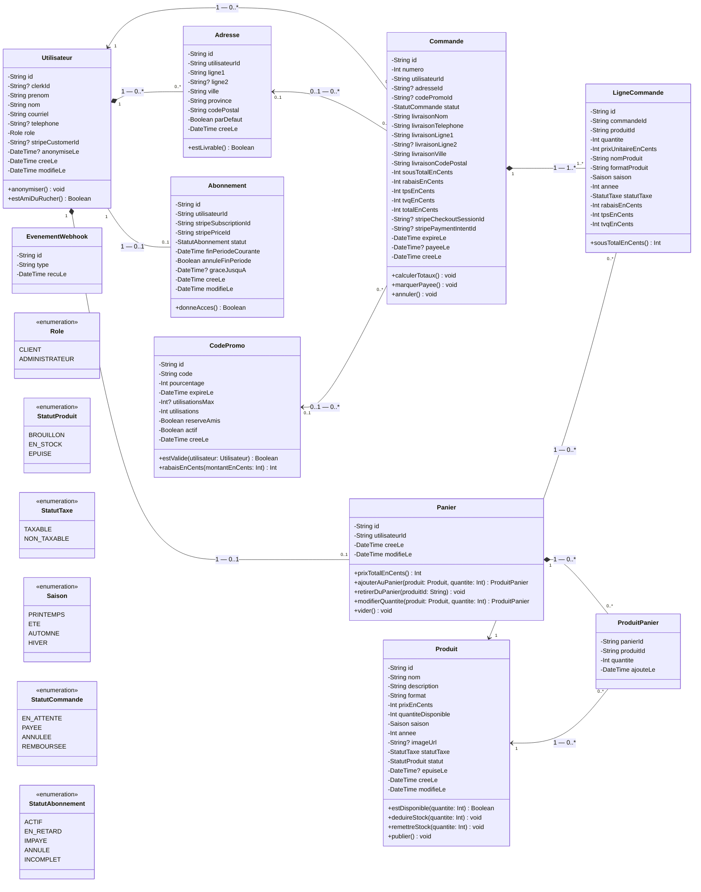

# Diagramme de classes — LeMiel-sur-Quévillon

Version 1.1. Tous les montants sont en cents (`Int`). Le schéma Prisma correspondant est dans `prisma/schema.prisma` ; les attributs, relations et choix de modélisation sont décrits à la section 9 du cahier des charges.

Légende : `*--` composition (la partie disparaît avec le tout), `-->` association. Les champs suivis de `?` sont optionnels.

`EvenementWebhook` n'a pas de relation : c'est un registre des événements Stripe déjà traités (RM-14).
