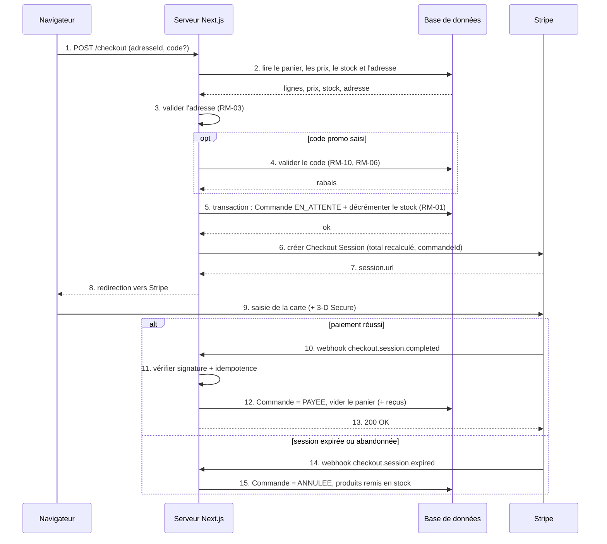
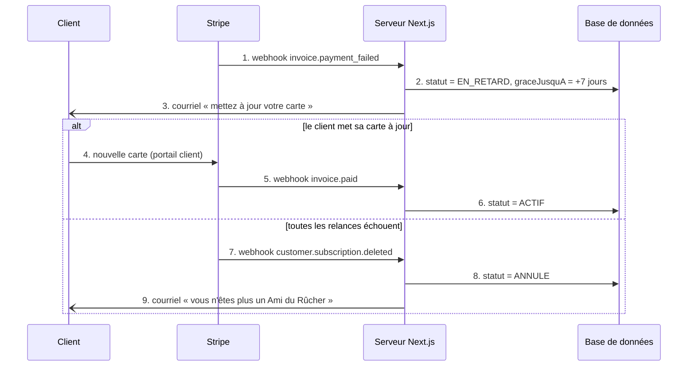

# Diagrammes de séquence — LeMiel-sur-Quévillon

Version 1.1. Les règles métier (RM) citées sont décrites à la section 7 du cahier des charges (`docs/cahier-des-charges.md`).

## 1. Achat de produits (paiement unique)

Le prix est recalculé par le serveur (RM-12) et seule la réception du webhook signé marque la commande payée (RM-15).

## 2. Échec de renouvellement de l'abonnement Amis du Rûcher

Règles appliquées : RM-05 (période de grâce), RM-06 (avantages réservés aux Amis du Rûcher valides).
